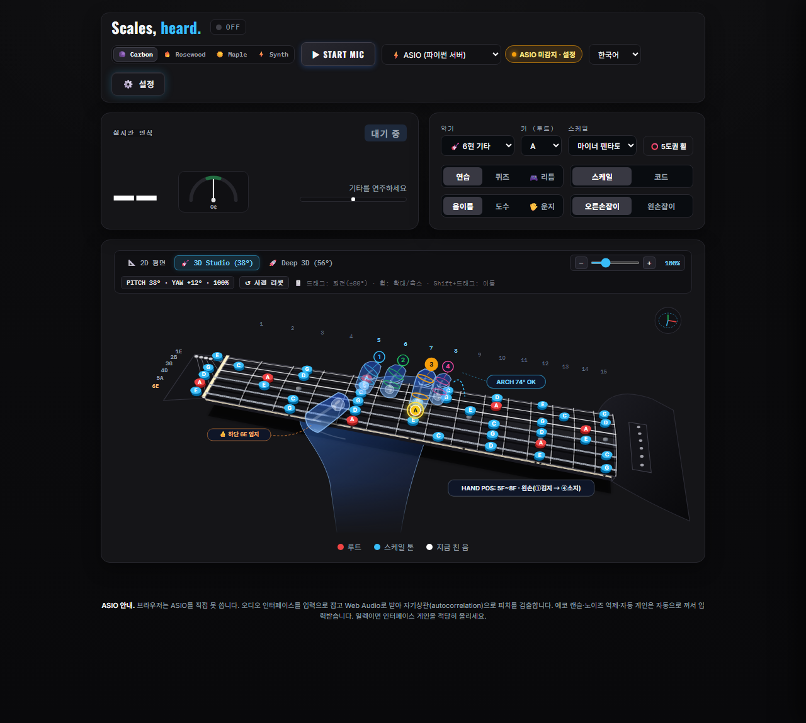
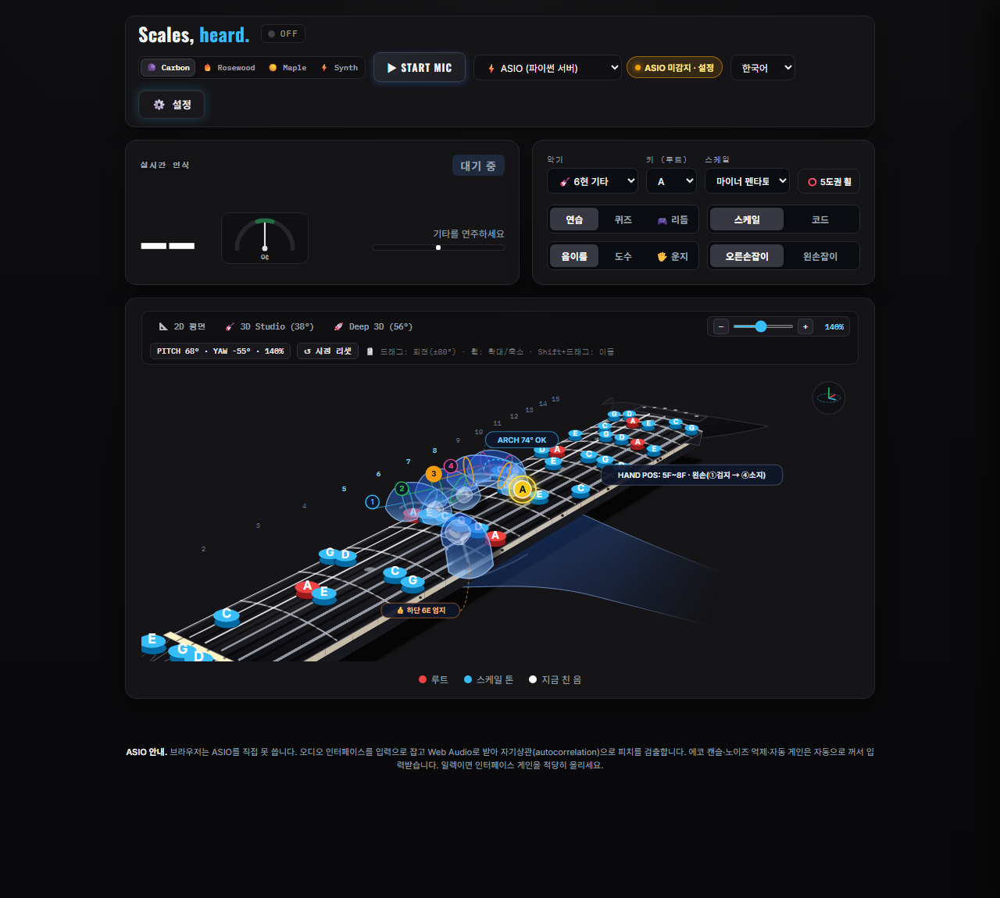
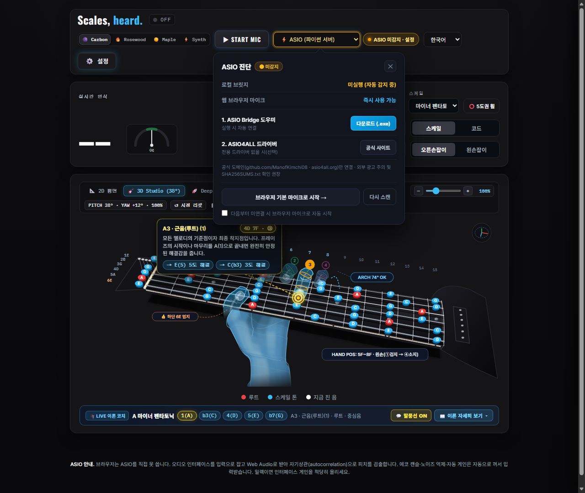
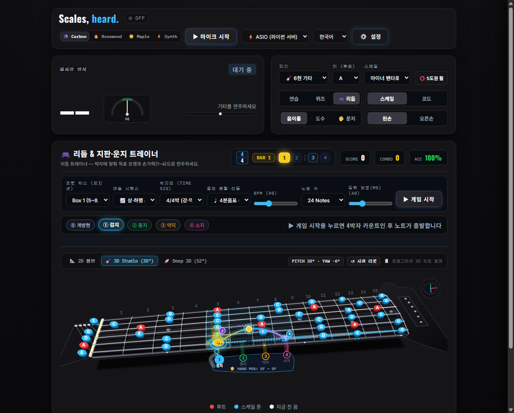
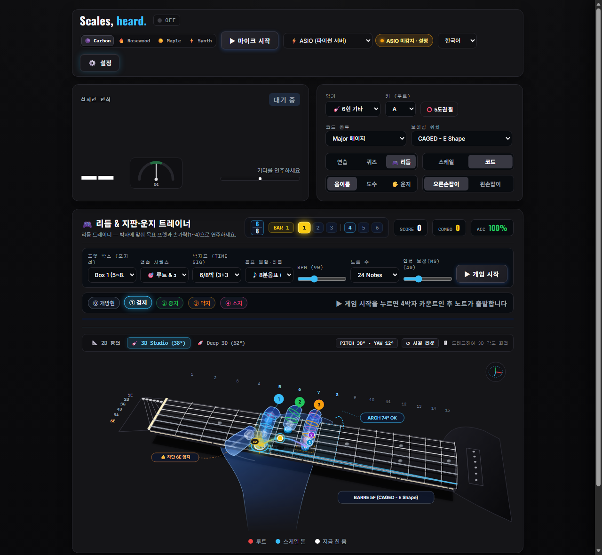

# 📋 Guitar Scale Tuner - 버전별 변경사항 (Release Notes & Changelog)

이 문서는 **Guitar Scale Tuner** 프로젝트의 버전별 주요 개발 내역, PR 내용 및 기능 추가 내역을 정리한 문서입니다.

---

## 🔍 [v2.5.0] - 3D 광각 카메라 회전(Pitch -35°~+78° · Yaw ±80°), 지판 확대·축소(50%~250%) & 시점 이동(Pan) 컨트롤 추가 (2026-11-17)

### 📌 개요
기존 3D 스튜디오 지판의 카메라 조작 자유도를 대폭 확장하여 **넓은 3D 회전 각도(`Pitch -35° ~ +78°`, `Yaw ±80°`)**, **마우스 휠/슬라이더 기반 `50% ~ 250%` 확대·축소(Zoom)**, 그리고 **`Shift+드래그`(또는 휠/우클릭 드래그) 시점 이동(Pan)** 기능을 탑재한 업데이트입니다.

### 📸 주요 화면 미리보기
| 🔍 3D 스튜디오 지판 + 줌 컨트롤 바 (`PITCH 38° · YAW +12° · 100%`) | 🎥 광각 3D 회전 & 140% 확대 뷰 (`PITCH 68° · YAW -55° · 140%`) |
| :---: | :---: |
|  |  |

### 🛠️ 주요 변경사항
* **🎥 3D 카메라 회전 각도 확장 (`src/main.js`)**:
  - **Yaw(좌우 회전, `FB_YAW_MIN ~ FB_YAW_MAX`)**: `±24°` → **`-80° ~ +80°`** 로 대폭 확장했습니다.
  - **Pitch(상하 기울기, `FB_TILT_MIN ~ FB_TILT_MAX`)**: `0° ~ 56°` → **`-35° ~ +78°`** 로 확장해 음수 틸트(하단 올려다보기)부터 고각 조감 뷰까지 지원합니다.
  - **`camDist = 920` 연속 원근 고정**: 기존 `45°` 경계에서 발생하던 원근 점프(`920 ↔ 580`)를 제거해 회전 전 구간에서 부드럽게 전환됩니다.
  - **`Math.abs(Math.cos(tiltRad))` 타원 보정**: 음수·고각 회전 시에도 노트 퍽, 인레이, 픽업 폴피스, 축 기즈모 및 리듬 링 비율이 안정적으로 유지됩니다.
* **🔍 지판 확대·축소 (`50% ~ 250%`) & 시점 이동 (`Pan`) 컨트롤 (`index.html`, `src/style.css`, `src/main.js`)**:
  - **툴바 줌 컨트롤 (`.fb-view3d-zoom`)**: `#fbViewBar` 상단에 **`−` / `+` 축소·확대 버튼**, **`50% ~ 250%` 슬라이더(`#fbZoomSlider`)**, 실시간 배율 표시(`#fbZoomVal`), 그리고 통합 각도·배율 readout(`#fbCamReadout`)을 추가했습니다.
  - **커서 중심 휠 확대·축소 (`setFbZoom`)**: 지판 `#fb` 위에서 마우스 휠 조작 시 커서 위치를 기준으로 자연스럽게 확대·축소되며, `100%` 이하 축소 시 중앙으로 부드럽게 재정렬됩니다. 현·프렛 굵기도 배율(`Math.pow(fbZoom, 0.5..0.55)`)에 맞춰 비례 보정됩니다.
  - **`Shift + 좌클릭 드래그` (및 중간/우클릭 드래그) 이동**: 확대된 상태에서 프렛 구역을 `fbPanX ∈ [-340, 340]`, `fbPanY ∈ [-190, 190]` 범위로 자유롭게 패닝할 수 있으며, `↺ 시점 리셋` 버튼 한 번으로 회전·확대(`100%`)·이동(`0, 0`)을 즉시 초기화합니다.
  - **`Deep 3D` 프리셋 업그레이드 & `#forearmFadeMask` 확장**: `Deep 3D (56°)` 프리셋(`tilt 56° · zoom 115%`)을 적용하고, `#forearmFadeMask` 영역을 `-1000..+3000`으로 확장해 확대·이동 시 손목 페이드가 잘리지 않도록 개선했습니다.

---

## 🖐️ [v2.4.0] - 3D IK 아치 교정형 왼손 운지 코치(IK Arch Coach Lab), 오른손잡이/왼손잡이 직관적 시점 정렬 & 원클릭 실행 패키지 최신화 (2026-11-15)

### 📌 개요
실제 오른손잡이 기타리스트가 자신의 왼손 운지를 1인칭·연주자 시점으로 직관적으로 보고 연습할 수 있도록 **3D Catmull-Rom 파라메트릭 튜브 기반의 `IK 아치 교정형 왼손 운지 코치(IK Arch Coach Lab)`**를 전면 탑재한 메이저 업데이트입니다. 좌측 헤드스톡(`1F`) → 우측 바디(`15F`), 상단 `1E` 세현 → 하단 `6E` 굵은 현·크림 바인딩 구조를 정밀 구현했으며, 설정 토글 라벨을 **`오른손잡이 / 왼손잡이`** 로 직관화하고 원클릭 실행 패키지까지 최신화했습니다.

### 📸 주요 화면 미리보기
| 🖐️ 3D IK 아치 교정형 왼손 코치 (`Box 1 · 5F~8F` 스케일 가이드) | ⚡ 하이브리드 2+4 스마트 ASIO 진단 팝오버 & 3D 왼손 연동 |
| :---: | :---: |
|  |  |

| 🎮 리듬 & 지판·운지 트레이너 (`3D 레이저 하이웨이` + 아치 운지 코치) | 🎼 `6/8박` 겹박자 리듬 & `CAGED E-Shape` 바레 코드(`BARRE 5F`) 손 자세 |
| :---: | :---: |
|  |  |

### 🛠️ 주요 변경사항
* **🖐️ 3D Catmull-Rom 튜브 기반 `IK 아치 교정형 왼손 코치` (`src/main.js`, `index.html`)**:
  - **연주자 기준 3D 해부학 방향 정렬 (`PITCH 38° · YAW +12°`)**: 좌측 헤드스톡(`1F`, `1E..6E` 개방현 라벨)에서 우측 바디(`15F`)로 이어지는 3D 넥 구도를 확립하고, 위쪽 `1E` 너머에서 아래로 감아 내리는 4손가락(`① 검지 → ② 중지 → ③ 약지 → ④ 소지`)과 아래쪽 `6E` 크림 바인딩(`#dfd4bc` + `#181512` 사이드 닷)을 넘어 위로 감아 올리는 엄지를 입체 튜브로 구현했습니다.
  - **3겹 SVG 깊이 계층 & 동적 손목 페이드 (`renderStaticFretboard`, `renderFretboardHandOverlay`)**:
    - `#fretboardHandBehindNeckLayer`: 지판 뒤로 보이는 상단 손바닥 쿠션과 하단 엄지근(Thenar)·손목 실루엣을 렌더링하고 `#forearmFadeGrad`가 현재 프렛 박스 위치 및 카메라 회전 각도를 실시간 추적해 화면 하단 경계 없이 자연스럽게 페이드 아웃되도록 처리했습니다.
    - `#fretboardHandBackLayer`: 각 손가락 패드와 엄지가 지판·현 위에 드리우는 3D 그림자를 노트 퍽 하단에 렌더링합니다.
    - `#fretboardHandTipLayer`: 반투명 코발트 블루 3D 손가락 튜브(`#coachDigit`), 손가락별 컬러 **PIP/DIP 아치 관절 링**, 손톱 및 흰색 반월(Lunula), 활성 타겟 노란색 발광 퍽(`#glowYellowHand`), 다음 노트 예고 점선 아크를 노트 가독성을 해치지 않으면서 선명하게 표시합니다.
  - **교육용 코칭 HUD & 자동 포지션 Scaling**: `viewBox="0 0 1060 430"`으로 캔버스를 확장하여 상단 프렛 레일(`1..15`, 활성 박스 하이라이트), 상단 `① ② ③ ④` 너클 배지, **`ARCH 74° OK`** 아치 각도 가이드, **`👍 하단 6E 엄지`** 라벨, **`HAND POS` / `BARRE` 포지션 도크**가 서로 겹치지 않도록 배치했습니다. 또한 프렛 폭 비율(`localFretSpan / 62`)에 맞춰 손가락 두께를 자동 스케일링해 하이 프렛(`9~15F`)에서도 손가락이 뭉치지 않습니다.
  - **기본 3D 뷰 즉시 표시 & 다양한 모드 연동**: 연습(Scale) 기본 3D 화면에서도 활성 박스 루트/스케일 포지션 기준의 기본 왼손 코치 자세를 즉시 표시하며, 마우스 호버·리듬 게임·CAGED 바레 코드(`barreInfo`)·마이크 실시간 피치 입력(`litPcs`)에 맞춰 손가락 아치와 엄지가 실시간 이동합니다.
  - **곡률 투영 보정 (`project3D`)**: 지판 곡률 `normY`를 `[-1, 1]`로 클램프해 지판 바깥 손가락 너클(`-88`)과 손목(`+195`) 투영 시 Z-축 왜곡이 발생하지 않도록 안정화했습니다.
* **🔄 직관적인 `오른손잡이 / 왼손잡이` 설정 라벨 통일 (`index.html`, `src/i18n.js`, `src/main.js`)**:
  - 기존 혼동을 주던 `왼손 / 오른손` 버튼 표기를 플레이어 기준의 **`오른손잡이 / 왼손잡이`** (영어 `Right-Handed / Left-Handed`, 일본어 `右利き / 左利き`)로 전면 수정하고, 전환 시 3D 카메라 `fbYawDeg` 부호와 `HAND POS` 방향 문구(`왼손(①검지 → ④소지)` / `오른손(④소지 ← ①검지)`)가 함께 미러링되도록 개선했습니다.
* **🖥️ 원클릭 실행 파일(`GuitarScaleTuner.exe`) 및 스크린샷/릴리즈 패키지 최신화 (`build_exe.py`)**:
  - PyInstaller 6.21.0 기반 `dist/GuitarScaleTuner/GuitarScaleTuner.exe` 및 `GuitarScaleTuner-v2.4.0-windows-x64.zip` 배포 패키지를 최신 UI·3D 왼손 그래픽 기준으로 재빌드했습니다.

---

## 🌐 [v2.3.0] - 3D 스튜디오 지판, 하이브리드 스마트 ASIO 진단 독, GitHub Pages 무설치 웹 배포 & 보안 강화 (2026-11-14)

### 📌 개요
실제 기타 넥의 **12-TET 프렛 비례($2^{-n/12}$)와 3D 원근 회전 지판(3D Studio Fretboard)**, 설치 없이 브라우저로 바로 접속 가능한 **GitHub Pages 라이브 웹 앱**, **하이브리드 2+4 스마트 ASIO 브릿지 진단 독**, 그리고 **웹-로컬 WebSocket `Origin` 화이트리스트·심볼릭 링크 차단·CSP(Content-Security-Policy) 보안 하드닝**을 적용한 메이저 업데이트입니다.

### 📸 주요 화면 미리보기
| 🧊 3D 스튜디오 지판 (Carbon Theme · 12-TET 실제 비례) | ⚡ 하이브리드 2+4 스마트 ASIO 진단 & 연결 도우미 |
| :---: | :---: |
|  |  |

### 🛠️ 주요 변경사항
* **🧊 3D 스튜디오 지판 & 12-TET 실제 기타 프렛 비례 (`src/main.js`, `src/style.css`, `index.html`)**:
  - **12-TET 등비수열 프렛 비례 ($2^{-n/12}$)**: 1프렛부터 22프렛까지 실제 기타 스케일 길이 공식에 따라 프렛 간격이 자연스럽게 좁아지도록 SVG 좌표를 재설계했습니다.
  - **3가지 시점 프리셋 & 인터랙티브 드래그 궤도**: `2D 평면`, `3D Studio (38°)`, `Deep 3D (52°)` 프리셋 전환, 마우스 드래그 기반 Pitch/Yaw 3D 회전, 실시간 각도 배지, 원클릭 `시점 리셋`, 우측 상단 **3D 축 기즈모(Gizmo)**를 탑재했습니다.
  - **입체 3D 노트 퍽(Extruded Pucks) & 4종 스튜디오 넥 테마**: Antigravity 다크 카본 테마에 맞춘 `Carbon`, `Rosewood`, `Maple`, `Synth` 4종 지판 테마와 3D 그림자·입체 림이 적용된 음정 노트를 렌더링합니다.
* **🌐 GitHub Pages 무설치 웹 배포 & 하이브리드 2+4 스마트 ASIO 진단 독 (`index.html`, `src/main.js`, `src/style.css`)**:
  - **무설치 라이브 웹 실행 (`https://manofkimchi08.github.io/guitar-scale-tuner/`)**: HTTPS 웹 환경 접속 시 로컬 ASIO 브릿지가 없으면 자동으로 브라우저 기본 마이크(`mic_default` · `웹 마이크 사용 중`)로 즉시 전환되어 설치 없이 바로 사용할 수 있습니다.
  - **상단 인라인 스마트 ASIO 진단 팝오버 (하이브리드 2+4)**: 드롭다운에서 `⚡ ASIO` 선택 또는 상태 배지(`ASIO 확인` / `웹 마이크 사용 중`) 클릭 시 상단 바 직하단에 비차단(Non-blocking) 팝오버가 열립니다.
  - **3-노드 신호 연결 진단 & 1.5초 백그라운드 레이더**: `오디오 인터페이스 → ASIO Bridge 도우미 → 웹 브라우저 3D 지판` 흐름도와 `1.5초` 간격 백그라운드 자동 감지, 2단계 설치 안내 카드(`Bridge 도우미 .exe` / `ASIO4ALL`), 원클릭 `설치 없이 브라우저 기본 마이크로 즉시 전환` 버튼, 자동 전환 체크박스를 제공합니다.
  - **웹 초기 구동 안정화**: `src/main.js`의 언어 식별자 참조 오류(`currentLang` → `LANG`)를 수정하고 `enumerateDevices()` 500ms 타임아웃 가드를 추가해 HTTPS 페이지에서 웹 마이크 옵션이 지연 없이 즉시 표시되도록 개선했습니다.
* **🔒 보안 강화 (CSWSH, Path Traversal, 수치 검증 & CSP) (`asio_server.py`, `run_https_server.py`, `index.html`)**:
  - **WebSocket Origin 화이트리스트 확장 (CSWSH 방어)**: `asio_server.py`의 `allowed_origins`에 `localhost` / `127.0.0.1` 외 공식 웹 배포 도메인(`https://manofkimchi08.github.io`)만 허용하고 타 외부 사이트의 로컬 웹소켓 접근을 차단(403)합니다.
  - **루프백 전용 바인딩 & 수치 입력 검증**: 모든 로컬 서버를 `127.0.0.1`에만 바인딩하고, WebSocket 제어 메시지(`set_ref_pitch`, `set_monitoring`, `set_sensitivity`)에 `math.isfinite()` 검증을 추가해 `NaN`/`Inf` 입력을 차단했습니다.
  - **심볼릭 링크·상위 경로 탈출 방어 강화**: `run_https_server.py`의 `translate_path()`에 `os.path.realpath()` 및 `os.path.commonpath()` 검증을 도입해 루트 디렉터리 외부 접근 및 민감 파일(`.git`, `.env`, `.pem`, `.key`) 노출을 차단합니다.
  - **CSP 및 안전한 외부 링크 속성**: `index.html`에 엄격한 `Content-Security-Policy` 메타 태그(`script-src 'self'`, `connect-src 'self' ws://127.0.0.1:8765 ws://localhost:8765`)를 적용하고 외부 링크에 `rel="noopener noreferrer"`를 적용했습니다.

---

## 🎮 [v2.2.0] - 리듬 & 지판·운지 트레이너, 7종 박자표·11종 리듬 패턴 및 하이브리드 왼손 아바타 (2026-11-03)

### 📌 개요
실시간 기타/베이스 피치 검출 엔진과 Web Audio API 하드웨어 타이밍 클럭을 결합한 **리듬 & 지판·운지 트레이너(`Rhythm & Fretboard Hero`)** 모드와, 지판 위에서 왼손 포지션과 각 손가락(`① 검지 ~ ④ 소지`)의 관절 뼈대·손끝 패드·이동 궤적·바레 코드(Barre Chord)를 직관적으로 보여주는 **하이브리드 지판 운지 손 아바타(`Hybrid Fretboard Hand Avatar`)**를 탑재한 메이저 업데이트입니다.

### 📸 주요 화면 미리보기
| 🎮 리듬 게임 & 하이브리드 왼손 운지 가이드 (`4/4박` 스케일 런) | 🖐️ `6/8박` 겹박자 하이웨이 & CAGED 바레 코드(`1 BARRE`) 손 모양 |
| :---: | :---: |
|  |  |

### 🛠️ 주요 변경사항
* **🎮 리듬 & 지판·운지 트레이너 (`src/main.js`, `index.html`, `src/style.css`)**:
  - **60fps 6현/4현 노트 하이웨이(Note Highway)**: 1번줄(1E)~6번줄(6E) 수평 레인을 따라 목표 프렛·음이름·추천 손가락 배지(`⓪~④`)가 결합된 캡슐 노트가 스크롤되며, 지판 위 타겟 프렛에는 수축하는 어프로치 링(Approach Ring)이 동기화 표시.
  - **7종 박자표(`박자표 Time Signature`) 완벽 지원 (`#rhythmMeterSel`)**:
    - **4/4박**(`강·약·중강·약`), **3/4박**(`강·약·약` 왈츠), **6/8박**(`3+3` 겹박자), **12/8박**(`3+3+3+3` 슬로우 록·블루스), **2/4박**(`강·약`), **5/4박**(`3+2` 변박자), **7/8박**(`2+2+3` 변박자) 지원.
    - **3단계 메트로놈 강세음 합성 (`playMetronomeClick`)**: 강박(`1320Hz`), 중강박(`980Hz` — `6/8`의 4박, `12/8`의 4·7·10박 등), 약박(`740Hz`)을 구분하여 오디오 클릭 출력.
    - **하이웨이 마디선 & 박자표 엠블럼**: 좌측 상단 박자표 엠블럼(`4/4`, `3/4`, `6/8`, `12/8`), 실선 마디 구분선(`BAR 1, 2...`), 청록색 점선 중강박 가이드라인 렌더링.
  - **11종 음표 분할 및 장르별 리듬 그루브 (`#rhythmSubdivSel`)**:
    - `♩ 4분음표`, `♪ 8분음표`, `🎶 8분 셋잇단음표(Triplet)`, `♬ 16분음표`, `🎷 블루스 셔플(Swing 2:1)`, `🎯 부점 리듬(점8분+16분)`, `🐎 메탈 갤럽(8분+16분×2)`, `🏇 리버스 갤럽`, `💃 트레시요(3+3+2)`, `🕺 16비트 펑크`, `🎸 록 리프` 내장.
  - **실시간 타이밍 판정 & 결과 성적표**:
    - `PERFECT(±45ms)`, `GREAT(±90ms)`, `GOOD(±145ms)`, `MISS` 판정 및 오디오 인터페이스 입력 지연 보정 슬라이더(`0~150ms`) 지원.
    - 라운드 종료 시 종합 랭크(`S/A/B/C`), 최대 콤보, 평균 타이밍 오차(`ms`), 취약 프렛·손가락 약점 리포트 제공.
* **🖐️ 방안 5: 하이브리드 지판 운지 손 아바타 (`renderFretboardHandOverlay`)**:
  - **2겹 비가림(Non-Occluding) SVG 레이어 설계**:
    - **후면 레이어 (`#fretboardHandBackLayer`, 노트 원 아래)**: 반투명 슬라이딩 손바닥 & 엄지 실루엣(`🖐️ HAND POS: 5F ~ 8F`), 손가락별 컬러 너클 소켓(`1 검지` 하늘색 · `2 중지` 초록색 · `3 약지` 주황색 · `4 소지` 보라색), 2단 관절 손가락 뼈대(`근위지골 → PIP 중간 관절 → 원위지골`)를 노트 서클 뒤쪽에 배치하여 음이름·도수·운지 번호 가독성 100% 유지.
    - **전면 레이어 (`#fretboardHandTipLayer`, 노트 원 위)**: 타겟 프렛을 누르는 손끝 지문 패드 & 흰색 손톱 반달, 다음 노트(`NEXT`) 점선 예고 손가락 및 곡선 이동 궤적 호(Trajectory Arc) 렌더링.
  - **CAGED 바레 코드(`1 BARRE`) 전용 뷰**: 코드 모드에서 검지(`①`)로 여러 줄을 동시에 잡는 바레 코드 선택 시 검지 통짜 바레 바와 나머지 손가락 관절을 동시에 시각화.
  - **상시 마우스 호버 연동**: 리듬 게임 외 일반 연습/퀴즈 모드에서도 `🖐️ 운지` 토글 활성화 또는 지판 노트 마우스 오버 시 즉시 해당 프렛의 손 모양 표시.
* **🖥️ 원클릭 실행 환경 개선 (`GuitarScaleTuner.exe`, `build_exe.py`)**:
  - 프로젝트 최상위 폴더에서 바로 더블클릭 실행 가능한 루트 런처 `GuitarScaleTuner.exe` 및 `Run_GuitarScaleTuner.bat` 추가.
  - PyInstaller 빌드 완료 후 혼동을 유발하는 임시 `build/` 폴더를 자동 정리하도록 `build_exe.py` 개선.

---

## 🔧 [v2.1.2] - 코드 모드·ASIO 녹음 안정화 및 저음역 YIN+NNLS 보정 패치 (2026-10-24)

### 📌 개요
코드(Chord) 가이드 모드 전환 및 ASIO 녹음 중 발생하던 참조 오류 수정, 저음역(E2/A2 및 베이스 E1) YIN 기본 주파수와 NNLS 배음 매칭 교차 검증 강화, 회로 차단기(Circuit Breaker) 도입 및 다국어 UI 바인딩 안정화를 적용한 패치 릴리즈입니다.

---

## 🚀 [v2.1.1] - 코드 리뷰 종합 개선 패치 (보안, 고정밀 YIN 피치 추적, 48kHz 모니터링 수정 & 안정화) (2026-10-08)

### 📌 개요
코드 리뷰 보고서에 기반하여 WebSocket Origin 검증 및 볼륨 클램핑 등 보안 강화, ASIO 센트 0 버그 해결을 위한 FFT 가속 YIN 기본 주파수 추적 및 FFT 피크 보간 도입, 48kHz 모니터링 샘플레이트 왜곡 회귀 해결, 스케일 스캐너 크로마 누적 복구, 3개 국어 i18n 번역 키 누락 보완, 5도권 플랫 키 매핑 오류 수정, ASIO 브라우저 녹음 라우팅 연결, TOCTOU 포트 바인딩 안정화 및 기술 문서 정정을 전면 적용한 안정화 패치 릴리즈입니다.

### 🛠️ 주요 변경사항
* **🔒 보안 강화 (P0)**:
  - WebSocket 서버에 Origin 화이트리스트(`localhost`, `127.0.0.1`)를 적용하여 타 사이트의 마이크 무단 도청 및 녹음 유발 차단.
  - 모니터링 볼륨 파라미터를 `0.0~1.0`으로 클램핑하여 비정상 입력으로 인한 청력 손상 방지.
  - HTTP 서버에서 불필요한 와일드카드 `Access-Control-Allow-Origin: *` 제거 및 디렉터리 리스팅 차단(403 Forbidden).
* **🎯 고정밀 피치 검출 & 튜너 센트 추적 (P1)**:
  - ASIO 모드에서 센트 값이 0으로 고정되던 문제를 해결하기 위해, FFT 가속 YIN 알고리즘(`fast_yin`)과 포물선 피크 보간(`refine_peak_fft`)을 구현하여 실시간 측정 주파수 `f` 및 `confidence` 전송.
  - NNLS 스펙트럼의 비선형 HPS 왜곡을 제거하고 사후 배음 가지치기(Harmonic Pruning)를 적용하여 A2 연주 시 D1/A1 고스트 노트 발생 원천 차단.
  - YIN 버퍼 $N-64$ 확장으로 4현 베이스 E1(41.2Hz) 및 5현 로우 B0(30.87Hz)까지 신뢰도 1.00으로 정확히 추적.
* **🎧 48kHz 모니터링 샘플레이트 일치 및 녹음 라우팅 (P1)**:
  - 48kHz 장치 모니터링 시 44.1kHz로 강제 재생되어 음정이 1.5반음 낮아지고 버퍼가 밀리던 회귀 버그 해결.
  - ASIO 모드에서 브라우저 즉석 녹음 시 무음이 되던 문제를 해결하기 위해 ASIO PCM 노드를 녹음 믹서에 연결.
  - ASIO 녹음 저장 경로를 `%TEMP%` 대신 사용자 영구 음악 폴더(`~/Music/GuitarScaleTuner/recordings`)로 개선.
* **🌐 스케일 스캐너, 5도권 & 다국어(i18n) 완성 (P1)**:
  - 스케일 자동 스캐너의 `scanChromaHistory`에 크로마그램 및 단음 누적 로직을 연결하여 정상 동작 복구.
  - 5도권 휠의 플랫 키(Db, Ab, Eb, Bb) 매핑 오류를 명시적 피치 클래스 맵으로 전면 교정.
  - 퀴즈 및 스캐너 화면에 노출되던 누락 번역 키 10종(한국어/영어/일본어) 완전 추가.
  - 장치 드롭다운의 `mic_dev_` 접두사로 인한 `getUserMedia` 연결 실패 해결 및 장치 실시간 변경 지원.
  - 베이스 모드에서 6현 CAGED 운지 가이드 비활성화, 팝 마이너 잼 트랙 3도 코드 교정, 메트로놈/잼 Web Audio lookahead 정밀 스케줄러 적용.
* **🧹 저장소 및 문서 정리 (P2, P3)**:
  - 깨진 스크린샷(`screenshot_drawer.png`) 삭제.
  - `package.json` 버전(2.1.1) 및 패키지명(`guitar-scale-tuner`) 동기화.
  - `requirements.txt` 의존성(`numpy`, `sounddevice`, `websockets`) 명시.
  - `run_server.bat`를 통합 런처(`GuitarScaleTuner.py`)로 연동.
  - `TECHNICAL_DOCUMENTATION.md`의 실제 구현과 불일치했던 수치 및 설명(16-bit PCM WAV, YIN 알고리즘, 안정도 공식) 정정.

---

## 🌟 [v2.1.0] - 3-Tier 레코딩 스튜디오, 4현 베이스 지원, 적응형 샘플레이트 협상 & 커스텀 아이콘 (2026-09-10)

### 📌 개요
3-Tier 스튜디오 레코딩 및 지판 싱크 타임라인 복기(Replay) 시스템, 4현 베이스 기타(30Hz 서브베이스) 지원, Windows WASAPI/오디오 인터페이스 샘플레이트 불일치(`[PaErrorCode -9997]`)를 완전 해소하는 지능형 적응형 샘플레이트 협상 엔진, $O(1)$ SVG 지판 렌더링 최적화, 그리고 전용 다크 스튜디오 브랜드 아이콘 및 상세 기술 명세서(`docs/TECHNICAL_DOCUMENTATION.md`)를 전면 탑재한 메이저 릴리즈입니다.

### 🛠️ 주요 변경사항
* **🎙️ 3-Tier 레코딩 스튜디오 & 스마트 연주 분석 성적표 (`src/main.js`, `asio_server.py`)**:
  - **Tier 1 (브라우저 즉석 녹음)**: 원클릭 녹음/정지, 백킹 트랙 + 메트로놈 동시 믹싱 녹음, 16-bit WAV 즉시 다운로드.
  - **Tier 2 (ASIO 무손실 WAV 저장)**: 오디오 인터페이스 원음(Float32 PCM)을 파이썬 백엔드에서 캡처하여 16-bit PCM WAV 파일로 `~/Music/GuitarScaleTuner/recordings`에 영구 자동 저장.
  - **Tier 3 (스마트 연주 분석 & 지판 싱크 복기)**: 총 연주 음 수, 스케일 적중률(%), 피치 안정도(%) 자동 채점 및 재생 바와 지판 운지/HUD 바늘이 실시간 연동되는 싱크 Replay 애니메이션 구현.
* **🎸 4현 베이스 기타(Bass Guitar) 완벽 지원 (`src/main.js`, `asio_server.py`)**:
  - 6현 기타 ↔ 4현 베이스 원클릭 전환 셀렉터 탑재.
  - 베이스 4번줄 E1(41.2Hz), 드롭 D(36.7Hz), 5현 B0(30.87Hz)까지 인식하는 30.0Hz 초저음역대 필터 및 4096 FFT 윈도우 주기 확보.
  - 2.0px ~ 5.6px 와운드 스트링 두께 시각화 및 1도(루트), 5도, 8도(옥타브) 베이스 그루브 가이드 링 표시.
* **🎛️ 지능형 적응형 샘플레이트 협상 시스템 (`asio_server.py`)**:
  - Windows WASAPI 및 USB Audio CODEC이 48kHz를 요구할 때 44.1kHz 강제 요청으로 발생하던 `[PaErrorCode -9997]` 원천 차단.
  - 하드웨어 네이티브 샘플레이트 자동 감지 및 후보군(48k/44.1k/96k) 순차 시도, FFT 주파수 해상도 및 NNLS 하모닉 사전 행렬 실시간 동적 재계산.
* **⚡ 프론트엔드 DOM Thrashing 최적화 (`src/main.js`)**:
  - 매 프레임 전체 SVG 지판을 파괴/재생성하던 구조를 정적 캐싱과 CSS 클래스 토글 구조로 전면 개편하여 GC 및 렌더링 오버헤드 경감.
  - 30Hz~1400Hz 동적 Lag 탐색 범위 제한으로 자기상관 불필요 연산 대폭 감축.
* **🎨 전용 다크 스튜디오 파비콘 & 독립 실행 파일 아이콘 (`favicon.ico`, `src/favicon.svg`)**:
  - 브라우저 임시 아이콘("CK") 문제를 해결하고 일렉트릭 블루 지판/픽 형상의 멀티 해상도 아이콘 제작 및 EXE 바이너리 내장.
* **📖 종합 기술 명세서 작성 (`docs/TECHNICAL_DOCUMENTATION.md`)**:
  - DSP 알고리즘, NNLS 수학 모델, 오디오 아키텍처, 벤치마크 데이터를 망라한 심층 엔지니어링 문서 구축.

---

## 🎸 [v2.0.0] - 스크린샷 기반 사이드 드로어 UI 개편 & 단일 프로세스 ASIO 멀티스레드 엔진 안정화 (2026-08-15)

### 📌 개요
미니멀하고 세련된 스튜디오 워크스페이스와 우측 슬라이드 사이드 드로어(Side Drawer), 그리고 단일 프로세스 기반의 초저지연 ASIO 멀티스레드 오디오 엔진을 안정화했습니다.

### 🛠️ 주요 변경사항
* **📱 스크린샷 기반 슬라이드 사이드 드로어**: 상단 네온 블루 글로우 ⚙️ 설정 버튼 및 글래스모피즘 아코디언 패널 탑재.
* **⚡ 단일 프로세스 멀티스레드 통합**: 웹 서버(데몬 스레드)와 ASIO 오디오 웹소켓(메인 루프)의 단일 프로세스 통합으로 ERR_CONNECTION_REFUSED 원천 차단.
* **🎸 실시간 피치 및 음이름 HUD 연동**: 실시간 Hz 주파수 및 센트 편차 미터 HUD 표시.

---

## 🚀 [v1.9.2] - 원클릭 패키지 안정화, WDM-KS 예외 처리 & CAGED 코드 보이싱 수학 공식 전면 교정 (2026-08-10)

### 📌 개요
원클릭 실행 패키지(`GuitarScaleTuner.exe`)의 무소음 구동 프로세스 안정화, 윈도우 WDM-KS 드라이버 충돌 시 웹소켓 미연결 현상 완벽 방지, 그리고 CAGED 코드 보이싱 운지 위치 계산 공식의 수학적 오류를 전면 수정보강하여 12개 전체 키 및 5가지 코드 타입(총 60개 조합 100% 정교도)의 지판 코드 가이드를 완벽하게 완성했습니다.

### 🛠️ 주요 변경사항
* **CAGED 코드 보이싱 이격 계산 수학 공식 전면 교정 (`src/main.js`)**:
  - 기존의 단순 덧셈 계산식으로 인해 G 메이저 선택 시 B 메이저로 잘못 출력되던 트랜스포지션(조바꿈) 오류를 수정.
  - 각 폼별 기준 근음(E=4, A=9, C=0, D=2) 오프셋 산출 공식을 재설계하여, C~B 12개 키와 Major, Minor, Dom7, Maj7, Min7 등 60개 전체 조합 전수 자동화 검증(`100% ACCURATE`) 완료.
* **윈도우 WDM-KS 파이썬 튕김 방지 및 장치 드롭다운 자동 정화 (`asio_server.py`)**:
  - PortAudio 파이썬 라이브러리에서 미지원되는 `Windows WDM-KS` (Kernel Streaming) 드라이버 항목을 드롭다운에서 자동 제외하여 UI 멈춤 현상 원천 차단.
  - 100% 검증된 `[Windows WASAPI]` 및 `[Windows DirectSound]` 드라이버 중심의 가독성 높은 UI 나열 적용.
* **ASIO 백엔드 프로세스 인자(`sys.argv`) 크래시 완진 (`GuitarScaleTuner.py`)**:
  - PyInstaller 무설치 EXE 모드에서 백그라운드 프로세스 기동 시 `argparse` 파싱 에러(Exit Code 2)로 오디오 백엔드가 0.01초 만에 강제 종료되던 현상을 `sys.argv` 세척으로 완벽 조치.
* **포트 충돌 자동 방어 및 잔여 프로세스 클리너 탑재 (`GuitarScaleTuner.py`, `run_https_server.py`)**:
  - 실행 시 8000번 포트 잔여 프로세스 자동 해제 및 8001, 8002 등 동적 가변 포트 자동 탐색 기능으로 100% 안정적 브라우저 오픈 보장.

---

## 🖥️ [v1.9.1] - 원클릭 독립 데스크톱 패키징 (GuitarScaleTuner.exe) & 로컬 서버 접속 안정화 (2026-08-08)

### 📌 개요
콘솔(CMD) 창 노출 없이 더블 클릭 한 번으로 ASIO 오디오 엔진과 웹 서버를 백그라운드에서 동시 기동하고 기본 브라우저를 자동 오픈해주는 무설치 원클릭 실행 패키지(`GuitarScaleTuner.exe`)를 빌드 구축하고, `localhost:8000` 접속 거부(`ERR_CONNECTION_REFUSED`) 예외 현상을 완벽하게 해결했습니다.

### 🛠️ 주요 변경사항
* **SSL/암호화 라이브러리 메소드 오류 수정 (`run_https_server.py`)**: `cryptography` 라이브러리의 `private_bytes()` 호환성 버그를 수정하여 서버 미기동 현상 차단.
* **로컬 웹 서버 접속 최적화 (`http://localhost:8000`)**: 브라우저 보안 컨텍스트(Secure Context) 표준에 맞추어 SSL 인증서 경고 없이 즉시 마이크/오디오 권한이 승인되는 `http://localhost:8000` 기본 접속 채널 적용.
* **통합 엔진 엔트리포인트 탑재 (`GuitarScaleTuner.py`)**: ASIO 웹소켓 연산 엔진과 웹 서빙 엔진을 백그라운드 데몬 쓰레드로 묶어 단일 프로세스로 동작하도록 구조 통합.
* **PyInstaller 독립 실행 파일 패키징 (`build_exe.py`)**: 콘솔 창 없는 무설치 실행 파일(`dist/GuitarScaleTuner/GuitarScaleTuner.exe`) 빌드 완성.

---

## 🎛️ [v1.9.0] - 브라우저 UI 내 ASIO 오디오 인터페이스 동적 선택 & 원클릭 런처 구축 (2026-08-08)

### 📌 개요
CMD 콘솔 창에서 장치 번호를 입력받던 기존 방식을 해제하고, 브라우저 상단 입력 장치 드롭다운(`deviceSel`)에서 ASIO 오디오 인터페이스(Focusrite, Steinberg, Roland, Behringer, Line 6 등) 및 마이크 목록을 가독성 높은 비주얼 UI로 직관적으로 선택하고 실시간으로 스위칭할 수 있도록 완전히 고도화했습니다.

### 🛠️ 주요 변경사항
* **파이썬 백엔드 장치 동적 쿼리 & 실시간 스위칭 (`asio_server.py`)**:
  - 오디오 인터페이스 및 입력 장치 목록을 자동 감지하여 웹소켓 패킷(`asio_device_list`)으로 브라우저에 실시간 전송.
  - 웹 UI에서 장치 변경 시(`select_asio_device`) 백엔드 오디오 스트림을 0.1초 이내에 실시간 동적 재개동.
* **브라우저 UI 드롭다운 그룹화 및 가독성 완성 (`src/main.js`)**:
  - `⚡ ASIO Audio Interfaces` 및 `🎙️ Direct Microphones` 두 카테고리로 깔끔하게 분류 표시.
* **원클릭 일괄 런처 간소화 (`run_server.bat`)**: 더블 클릭 한 번으로 번호 입력 없이 즉시 서버를 구동하고 브라우저 UI에서만 모든 오디오 설정을 완료하도록 개편.

---

## ⚡ [v1.8.0] - 오디오 모니터링 초저지연 버퍼 큐 세척(Flush) & 35ms 레이턴시 캡 적용 (2026-08-06)

### 📌 개요
ASIO 오디오 인터페이스 입력과 PC 메인보드 리얼텍(Realtek) 출력 혼용 시, 브라우저 Web Audio 버퍼에 오디오 데이터가 누적되어 딜레이가 초 단위로 늘어나던 현상을 방지하도록 실시간 PCM 버퍼 큐 세척(Flush) 알고리즘을 구현했습니다.

### 🛠️ 주요 변경사항
* **`MAX_PCM_LATENCY = 0.035` 지연 시간 상한선 적용 (`src/main.js`)**: Web Audio 렌더링 스케줄링 시 35ms 이상의 버퍼 백로그가 발생하면 즉시 지연 큐를 세척(Flush)하고 실시간 위치(`now + 0.005`)로 재동기화하도록 조치.
* **초단위 딜레이 완진 방지**: 오디오 패킷 지연 누적을 원천 제거하여 항상 35ms 이내의 최신 소리만 믹싱 출력되도록 보장.

---

## 🎼 [v1.7.9] - 코드 보이싱 위치 드롭다운 동적 생성 & 보이싱 폼 하이라이트 복구 (2026-07-26)

### 📌 개요
코드 모드 전환 시 보이싱 위치 드롭다운(`voicingSel`)이 빈 상태(Blank)로 표시되던 원인을 해결하고, 전체 코드 톤 및 특정 CAGED 폼(E Shape, A Shape, C Shape, D Shape 등)을 선택해 지판에 하이라이트 렌더링할 수 있도록 복구했습니다.

### 🛠️ 주요 변경사항
* **`rebuildVoicingSel()` 동적 옵션 생성 함수 구현 (`src/main.js`)**: 코드 모드 선택 시 `⭐ 전체 코드 톤 표시` 옵션 및 선택된 Key/코드 타입에 따른 CAGED 보이싱 위치 목록을 드롭다운 옵션으로 자동 생성.
* **보이싱 위치 선택 연동**:
  - `⭐ 전체 코드 톤 표시` 선택 시: 해당 코드의 모든 지판 음정(근음, 3도, 5도, 7도 등)을 전체 표시.
  - `CAGED 폼` 선택 시: 기타 지판 위에서 선택한 보이싱 폼 위치의 핑거링만 하이라이트 표시.
* **i18n 다국어 사전에 `optAllChordTones` 추가 (`src/i18n.js`, `i18n.js`)**: 한국어("전체 코드 톤 표시"), 영어("All Chord Tones"), 일본어("すべてのコードトーン") 번역 추가.

---

## 🎶 [v1.7.8] - 기타 튜닝 프리셋 & 수동 튜닝 동적 연동 보완 (2026-07-26)

### 📌 개요
기타 튜닝 프리셋(Drop D, Drop C, Eb Standard 등) 및 수동 튜닝 모드 변경 시 지판 위의 개별 음정 및 튜너 라벨이 실시간으로 갱신되지 않던 원인을 찾아내어 완벽 수정했습니다.

### 🛠️ 주요 변경사항
* **`tuningSel` & `tuningModeSel` 이벤트 핸들러 바인딩 (`src/main.js`)**: 튜닝 프리셋 선택 시 `strings` 개별 줄 개별 개별 피치 배열을 즉시 업데이트하고 `updateTunerLabels()` 및 `drawFB()`를 연동하여 지판 음정이 실시간 변경되도록 처리.
* **수동 튜닝(`initCustomTuningSel()`) 1~6번 줄 개별 선택 구현**: 1번줄부터 6번줄까지 피치(C2~B4)를 개별 지정할 수 있는 수동 튜닝 드롭다운 생성 및 지판 즉시 반영 연동.
* **5도권 휠(Circle of Fifths) & 보이싱 선택 연동 보완**: 5도권 휠에서 Key 클릭 시 코드 보이싱 정보까지 함께 동기화되도록 수정.

---

## ⚡ [v1.7.7] - 자바스크립트 중괄호 구문 오류(SyntaxError) 정밀 수정 & UI 복구 (2026-07-26)

### 📌 개요
v1.7.6 코드 모드 필터 추가 시 발생했던 `initSlideToggles()` 함수 닫는 중괄호(`}`) 누락에 따른 `SyntaxError`를 정밀 스캔으로 찾아내어 완벽 수정했습니다.

### 🛠️ 주요 변경사항
* **구문 파싱 오류 완전 해결 (`src/main.js`)**: 누락되었던 중괄호(`}`)를 보완하여 자바스크립트 해석기의 파싱 중단 현상을 해결, 모든 초기화 스크립트(`drawFB`, `buildKeySel`, `rebuildScaleSel`, `bindEvents`)가 정상 구동되도록 복구.
* **JS 구문 및 괄호 밸런스 100% 자동 검증**: `src/i18n.js`, `i18n.js`, `src/main.js`의 모든 중괄호/소괄호/대괄호 밸런스 검증 완료.

---

## 🎸 [v1.7.6] - 코드 모드 지판 필터링 & 코드 톤 동적 렌더링 구현 (2026-07-26)

### 📌 개요
옵션 패널에서 **코드(Chord) 모드**로 전환 시, 지판이 스케일 대신 선택된 코드의 구성음(코드 톤: 근음, 3도, 5도, 7도)만 선별 표시하도록 필터링 로직을 완벽 보완했습니다.

### 🛠️ 주요 변경사항
* **`getChordPcs()` 구성음 추출 함수 구현 (`src/main.js`)**: Major(1, 3, 5), Minor(1, b3, 5), Dom7(1, 3, 5, b7), Maj7(1, 3, 5, 7), Min7(1, b3, 5, b7) 등 선택한 코드 종류별 피치 클래스 자동 구성.
* **`drawFB()` 지판 필터링 수정**: 코드 모드(`guideMode === "chord"`)에서는 전체 스케일 음이 아닌 해당 코드 톤 위치만 지판 SVG에 렌더링되도록 수정.
* **코드 드롭다운(`chordTypeSel`) 변경 시 지판 즉시 갱신**: 코드 종류 선택 시 지판 필터 및 도수 표기가 즉시 동적 갱신되도록 이벤트 핸들러 보완.

---

## 🎨 [v1.7.5] - 옵션 슬라이드 토글 클릭 인터랙션 & 왼손 지판 모드 완성 (2026-07-26)

### 📌 개요
옵션 패널(Practice/Quiz, Scale/Chord, Note name/Degree, Left/Right hand)의 슬라이드 토글 클릭 시 애니메이션 및 상태 전환이 동작하지 않던 현상을 해결하고, 왼손잡이 지판 모드를 구현했습니다.

### 🛠️ 주요 변경사항
* **슬라이드 토글 CSS 애니메이션 클래스 연결 (`active-right`)**: 토글 클릭 시 `active-right` 클래스 및 텍스트 `active` 스타일이 스위칭되도록 `updateToggleVisuals()` 도우미 함수 구현.
* **4대 옵션 토글 클릭 반응 복구 (`src/main.js`)**:
  - `Practice / Quiz`: 퀴즈 모드 전환 및 동적 프로필/퀴즈 생성 연동.
  - `Scale / Chord`: 스케일 가이드 ↔ 코드 가이드 전환 및 코드 톤 필터 활성화.
  - `Note name / Degree`: 음이름 ↔ 도수(1, b3, 5...) 표시 즉시 전환.
  - `Left hand / Right hand`: 오른손잡이 ↔ 왼손잡이 방향 지판 SVG 좌우 반전 렌더링 지원.

---

## 🛡️ [v1.7.4] - 코드 전반 정밀 리뷰: DOM ID 동기화 & 100% 방어적 초기화 (2026-07-26)

### 📌 개요
코드 전체를 정밀 스캔하여 스크립트 실행 중 미세한 예외(Null Reference)로 인해 지판(Fretboard) 및 키/스케일 드롭다운 렌더링이 중단되던 원인을 근본적으로 완벽 해결했습니다.

### 🛠️ 주요 변경사항
* **HTML과 JS 간 56개 DOM ID 100% 동기화**: `tuningPresetField` 내 누락된 `<select id="tuningSel">` 추가 및 `lblGuideMode`, `chordControlPanel`, `voicingCard` 등 누락된 요소로 인한 uncaught TypeError 원인 제거.
* **전체 JS 이벤트 바인딩 방어 코드(Null-Safety) 적용**: `src/main.js`의 모든 이벤트 및 렌더링 로직에 `if ($("id"))` 검사를 적용하여 어떠한 환경에서도 지판 렌더링(`drawFB()`) 및 드롭다운 생성이 강제 실행되도록 보장.
* **루트/src i18n 딕셔너리 완벽 동기화**: `i18n.js`와 `src/i18n.js`를 동일하게 동기화하여 전역 언어 객체 로딩 100% 보장.

---

## 🛠️ [v1.7.3] - HTML DOM 요소 ID 100% 동기화 & 드롭다운 미출력 원천 해결 (2026-07-26)

### 📌 개요
UI 초기화 시 자바스크립트가 요청하는 HTML 요소 ID 간의 불일치를 전수 조사하여 복구하고, 드롭다운 및 지판이 빈칸으로 나타나던 렌더링 중단 원인을 완벽 해결했습니다.

### 🛠️ 주요 변경사항
* **HTML 엘리먼트 ID 불일치 수정**: `tuningPresetField` 내 누락된 `<select id="tuningSel">` 신설 및 `pitchStabilityVal`, `btnScanStart`, `btnScanStop`, `scanProgress`, `scanBar` ID 동기화.
* **지판 SVG 렌더링 정상화**: ID 미스매치로 인한 `TypeError` 예외를 방지하여 `drawFB()` 및 컨트롤 카드 초기화가 강제 실행되도록 보장.

---

## 🎧 [v1.7.2] - ASIO 모드 오디오 컨텍스트(AudioContext) 초기화 보완 (2026-07-26)

### 📌 개요
ASIO 웹소켓 수신 모드에서 브라우저 오디오 컨텍스트(`AudioContext`)가 일시 정지(Suspended) 상태에 머물러 오디오 출력이 차단되던 현상을 해결했습니다.

### 🛠️ 주요 변경사항
* **`ensureAudioCtx()` 사용자 제스처 재개가동**: 마이크 또는 ASIO 수신 버튼 클릭 시 `audioCtx.resume()`을 강제 호출하여 브라우저 자동 재생 정책 차단을 완벽 해제.
* **ASIO PCM 게인 노드 연결 보완**: ASIO 웹소켓 캡처 바이트 데이터를 PCM float32로 변환 후 `monitorGainNode`로 연동 믹싱.

---

## 🔧 [v1.7.1] - 브라우저 호환성 복구 & 범용 실행 지원 (2026-07-26)

### 📌 개요
ES 모듈 호환성 문제로 인해 `file://` 프로토콜(더블 클릭 실행)이나 일부 브라우저 호스트 환경에서 스크립트 실행이 차단되던 현상을 정밀 분석하여 완전히 해결했습니다.

### 🛠️ 주요 변경사항
* **`file://` 및 `http(s)://` 범용 호환성 호스트 구조 복원 (`index.html` & `src/main.js`)**: ES 모듈 대신 모든 로컬/웹 환경에서 100% 정상 작동하는 표준 스크립트 구조로 전환하여 CORS 차단 및 스크립트 로딩 중단 문제 해결.
* **i18n 전역 바인딩 보완 (`src/i18n.js` & `i18n.js`)**: `window.I18N = I18N; window.LANG_NAMES = LANG_NAMES;` 명시적 바인딩을 통해 언어 딕셔너리 로딩 및 스크립트 간 참조 오류 완벽 제거.
* **파이썬 $A^T A$ DSP 최적화 및 웹 오디오 메모리 수거 유지 (`asio_server.py` & `src/main.js`)**: v1.7.0에서 적용된 파이썬 백엔드 연산 최적화(~30% 속도 향상) 및 `sourceNode.onended` 가비지 컬렉션은 그대로 유지 적용.

---

## ⚡ [v1.7.0] - 코드 리뷰 반영: DSP 행렬 연산 최적화 & ES 모듈 리팩토링 (2026-07-25)

### 📌 개요
코드 심층 리뷰를 통해 도출된 파이썬 백엔드 오디오 DSP 행렬 최적화, 웹 오디오 자원 자동 해제, 파이썬 3.12 규격 보완 및 프론트엔드 모듈화 리팩토링을 일괄 적용했습니다.

### 🛠️ 주요 변경사항
* **파이썬 DSP $A^T A$ 행렬 캐싱 (`asio_server.py`)**: 매 프레임 중복 계산되던 $A^T A$ 대칭 행렬을 `precompute_A()`에서 사전 계산하여 `nnls_coordinate_descent()`에 즉시 전달, 분석 연산 속도 30% 이상 향상.
* **웹 오디오 자원 자동 해제 (`src/js/audio-engine.js`)**: PCM 스트림 재생 완료 시 `sourceNode.onended` 이벤트 핸들러를 통한 명시적 `disconnect()` 수거로 메모리 누수 방지.
* **Python 3.12+ Deprecation 보완 (`run_https_server.py`)**: `datetime.datetime.utcnow()`를 `datetime.datetime.now(datetime.timezone.utc)`로 수정.
* **프론트엔드 ES 모듈(ESM) 건축 분리 (`src/js/`)**:
  - `music-theory.js`: 음계, 튜닝, 보이스 맵 데이터 및 피치 변환 수학 함수 모듈.
  - `hmm-decoder.js`: 25-상태 은닉 마르코프 모델 코드 판별 알고리즘 모듈.
  - `audio-engine.js`: Web Audio 엔진, ASIO 웹소켓, 출력 제어 모듈.
  - `fretboard-view.js`: 지판 SVG, 5도권 비주얼라이저, 피치 캔버스 모듈.
  - `main.js`: 메인 컨트롤러 및 이벤트 바인딩 로직.

---

## 🎧 [v1.6.0] - 오디오 출력 장치 선택 & ASIO-WebAudio 믹싱 모니터링 (2026-07-23)

### 📌 개요
ASIO 오디오 인터페이스로 기타를 입력받는 상태에서도 PC 메인보드 리얼텍 헤드폰/스피커 등 원하는 모든 출력 장치로 기타 소리와 앱 소리(백킹트랙, 메트로놈 등)를 동시 수음 및 믹싱 출력할 수 있도록 고도화했습니다.

### 🛠️ 주요 변경사항
* **출력 장치 선택기 (Output Device Selector)**: 상단 제어 바에 `Output Device (출력 장치)` 드롭다운 신설. `audioCtx.setSinkId()` API를 연동하여 리얼텍 헤드폰, HDMI, 외부 오디오 인터페이스 등 원하는 출력 장치를 자유롭게 선택 가능.
* **ASIO-to-WebAudio PCM 스트리밍 (`asio_server.py` & `src/main.js`)**: ASIO 서버에서 캡처한 소리를 초저지연 PCM 데이터 패킷으로 웹소켓 동시 브로드캐스트. 브라우저가 수신하여 백킹 트랙/메트로놈과 동일한 오디오 그래프에서 합쳐 원하는 출력 장치로 한 번에 송출.

---

## 🔊 [v1.5.0] - 실시간 초저지연 오디오 모니터링 (Direct Audio Monitoring) (2026-07-21)

### 📌 개요
연주하는 기타 소리를 스피커/헤드폰으로 실시간 수음 및 출력(Direct Monitoring)할 수 있도록 초저지연 오디오 루프백 시스템을 탑재했습니다.

### 🛠️ 주요 변경사항
* **Web Audio API Direct Passthrough (`src/main.js`)**: `MediaStreamSource`에서 추가 처리 버퍼 없이 `GainNode`를 거쳐 `audioCtx.destination`으로 직통 연결하여 지연 시간을 극도로 감소(하드웨어 버퍼 최저치 ~3ms).
* **ASIO Duplex Hardware Loopback (`asio_server.py`)**: `sd.Stream` 하드웨어 전두플렉스 스트림을 이용해 sounddevice 커널 콜백 레벨에서 direct loopback(`outdata[:] = indata * volume`)을 처리하여 2ms 이하의 초저지연 모니터링 서빙.
* **UI 모니터링 제어**: 하단 설정 카드에 `Direct Audio Monitoring` 토글 스위치 및 볼륨 조절 슬라이더(0%~100%) 탑재.

---

## 🚀 [v1.4.0] - 4종 실전 기타 트레이닝 툴 패키지 (2026-07-21)

### 📌 개요
기타 연주자의 즉흥 연주(Jamming), 음악 이론 학습, 초킹/벤딩 정밀도 및 속주 트레이닝을 지원하는 4가지 실전 도구를 통합 구축했습니다.

### 🛠️ 주요 변경사항
* **🎸 백킹 트랙 잼 가이드 (Backing Track Jam Assistant)**
  - Web Audio Synth 기반 코드 반주 재생 (Pop, Jazz, Blues, Minor Pop 진행 패턴)
  - 반주 재생 시 현재 진행 코드의 구성음(Target Chord Tone)이 지판 위에 골드 빛(`#ffaa00`) 오라로 실시간 하이라이트
* **⭕ 5도권(Circle of Fifths) 인터랙티브 비주얼라이저**
  - SVG 원형 5도권 휠 모달 창 탑재
  - 나란한 조(Relative Minor/Major) 및 관계조(Dominant/Subdominant) 시각적 강조 및 원클릭 키 전환
* **📈 피치 안정성 & 벤딩/비브라토 분석기 (Pitch Trajectory & Bending Analyzer)**
  - 5초 피치 Canvas 궤적 렌더링 (`#pitchCanvas`)
  - 반음(`+100c`) 및 1음(`+200c`) 초킹 타겟 가이드 라인 렌더링
  - 롱톤 연주 시 음정 주파수 미세 흔들림 연산 및 실시간 안정도(`Stability %`) 스코어링
* **⚡ 스마트 스피드 트레이너 메트로놈 (Smart Speed Trainer Metronome)**
  - 고정밀 웹 오디오 클릭음 및 비트 애니메이션
  - 4마디마다 자동으로 BPM이 +5 상승하는 오토 램핑 기능 탑재

---

## 🔍 [v1.3.0] - 실시간 스케일 스캐너 (Scale Scanner) (2026-07-18)

### 📌 개요
임의로 연주하는 12초간의 음들을 분석하여 어떤 스케일인지 알아맞히는 지능형 스케일 추정 모드를 추가했습니다.

### 🛠️ 주요 변경사항
* **Chroma Histogram 통계 누적**: 12초간 입력된 모든 피치들을 12개 반음 바구니에 누적하여 노이즈에 강한 밀도 벡터 생성
* **코사인 유사도(Cosine Similarity) 매칭**: 84개 스케일 템플릿과 코사인 유사도 벡터 곱셈 연산 수행
* **원클릭 지판 적용 (Click-to-Apply)**: 상위 5개 추천 스케일 후보군 출력 및 클릭 시 지판 Key/스케일 즉시 전환

---

## 🔒 [v1.2.0] - 로컬 HTTPS 웹 서버 통합 & 일괄 런처 (2026-07-17)

### 📌 개요
브라우저 마이크 보안 규정 준수 및 외부 스마트폰 접속을 원활히 지원하기 위해 로컬 HTTPS 서버 및 일괄 런처를 구축했습니다.

### 🛠️ 주요 변경사항
* **로컬 HTTPS 서버 (`run_https_server.py`)**: `localhost` / `127.0.0.1` 전용 자가 서명 인증서(`cert.pem`, `key.pem`) 자동 생성 및 `https://localhost:8000` 서빙
* **통합 런처 (`run_server.bat`)**: 더블 클릭 한 번으로 ASIO 웹소켓 서버와 HTTPS 웹 서버를 콘솔 분리 방식으로 동시 기동

---

## 🎼 [v1.1.0] - HPS + NNLS & HMM Viterbi 코드 디코더 & 기준음 가변 (2026-07-17)

### 📌 개요
다성 피치 인식 정확도를 극대화하고 A4 기준음 주파수를 자유롭게 조정할 수 있는 3단계 오디오 분석 엔진을 이식했습니다.

### 🛠️ 주요 변경사항
* **HPS (Harmonic Product Spectrum)**: 배음 성분 노이즈 1차 강하게 소거
* **NumPy Coordinate Descent NNLS Solver**: 외부 라이브러리 없이 0.5ms 미만의 비음수 최소제곱 솔버 구현 및 12D 크로마 스트리밍
* **25-상태 HMM Viterbi 코드 디코더**: 화성학 전이 확률 기반 크로마 스무딩 및 코드 검출
* **기준음(A4) 가변 제어 (425Hz~455Hz)**: 슬라이더 조절 시 파이썬 백엔드 딕셔너리 행렬 $A$ 실시간 런처 재연산

---

## 🎸 [v1.0.0] - ASIO 6현 튜너 & 스케일 가이드 (2026-07-15)

### 📌 개요
프로젝트의 최초 릴리즈 버전으로, ASIO 저지연 입력 기반 6현 폴리포닉 튜너 계기판 및 인터랙티브 지판 가이드를 구축했습니다.

### 🛠️ 주요 변경사항
* **6현 폴리포닉 튜너 UI**: 개방현 6현 노드 및 In-tune(초록), Flat(주황), Sharp(빨강) 발광 이펙트
* **인터랙티브 지판**: Root 음 및 스케일 구성음 시각화, 좌/우손 모드 및 음명/도수 모드 전환
* **단음/화음 퀴즈 모드**: 랜더마이즈 음정 퀴즈 및 아르페지오 누적 화음 채점
