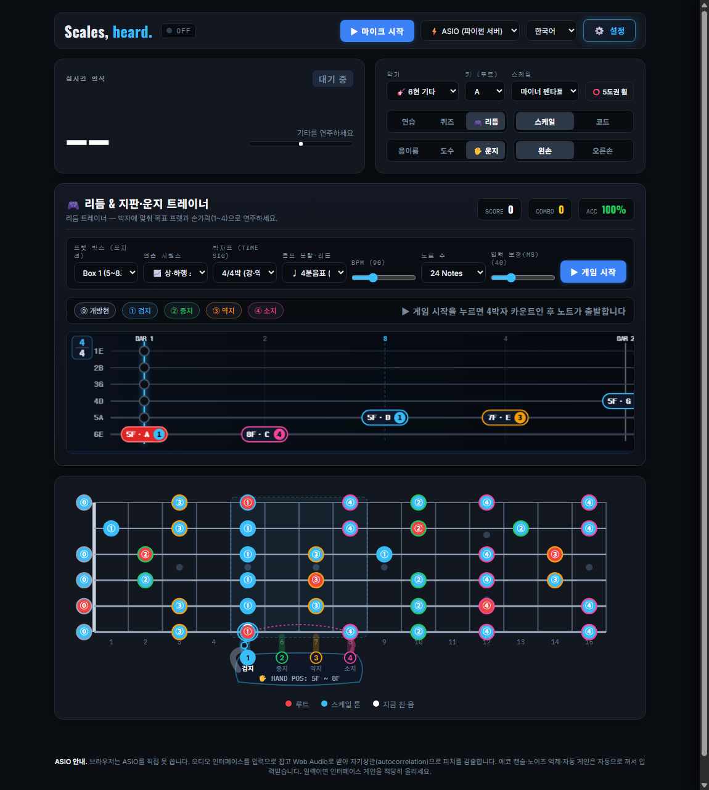
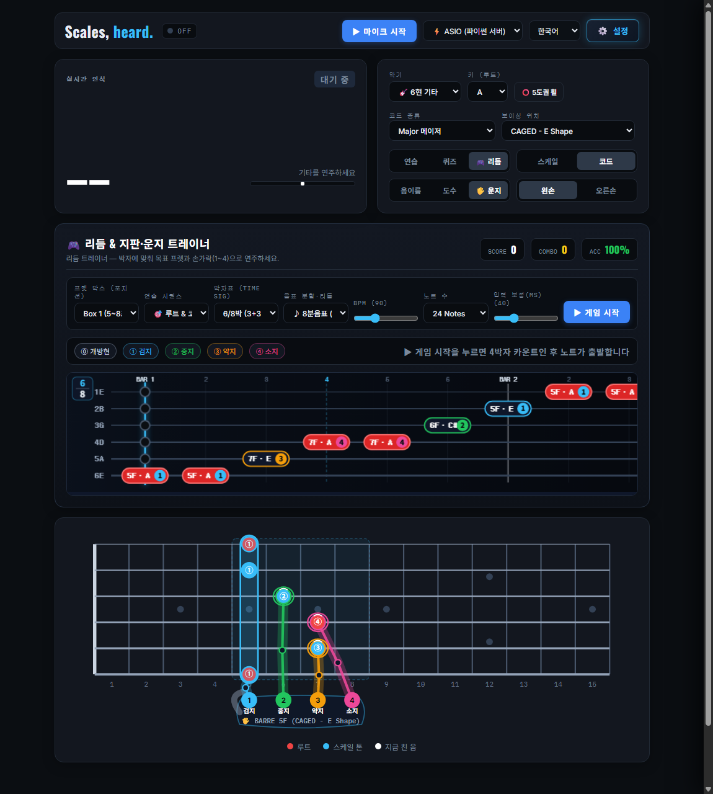

# Scales, heard. 🎸

**エレキギター＆ベースの実音をリアルタイムで聴き取る、超低遅延フレットボード・スケールガイド、リズムゲーム＆スマート運指トレーナー**

[](https://github.com/ManofKimchi08/guitar-scale-tuner/releases)
[](LICENSE)
[]()

> 🌐 **Language / 언어 / 言語**: **[🇺🇸 English](README.md)** | **[🇰🇷 한국어](README.ko.md)** | **[🇯🇵 日本語](README.ja.md)**

---

## 📸 スクリーンショット & UIツアー (Screenshots)

| 🎮 リズム＆指板・運指トレーナー (`4/4拍子` スケールラン + ハイブリッド左手アバター) | 🖐️ `6/8拍子` 複合拍子ハイウェイ + CAGEDバレーコード(`1 BARRE`) 運指ガイド |
| :---: | :---: |
|  |  |

| 🎸 6弦ギター指板 & リアルタイムピッチHUD | 🎸 4弦ベースギター (1-5-8 グルーヴガイド) | 🎙️ 3-Tier レコーディングスタジオ & 指板シンクロ再生 |
| :---: | :---: | :---: |
|  |  |  |

---

## 🌟 主な機能 (v2.2.0)

### 1. 🎮 リズム＆指板・運指トレーナー (`Rhythm & Fretboard Hero`)
- **60fps 6弦/4弦ノートハイウェイ(Note Highway)**: Web Audio APIのハードウェアクロック(`audioCtx.currentTime`)に完全同期した水平スクロールTABハイウェイと、下部SVG指板上の収縮アプローチリング(Approach Ring)がリアルタイムに連動します。
- **7種類の拍子記号 (`拍子記号 Time Signature`) に対応**:
  - **単純拍子・複合拍子・変拍子**: **4/4拍子**(`強・弱・中強・弱`)、**3/4拍子**(`強・弱・弱` ワルツ)、**6/8拍子**(`[3+3]` 複合2拍子)、**12/8拍子**(`[3+3+3+3]` スローロック・ブルース)、**2/4拍子**(`強・弱`)、**5/4拍子**(`[3+2]` 変拍子)、**7/8拍子**(`[2+2+3]` 変拍子)を搭載。
  - **3段階のメトロノーム強拍アクセント**: **強拍(`1320Hz`)**、**中強拍(`980Hz` — `6/8`の4拍目、`12/8`の4・7・10拍目など)**、**弱拍(`740Hz`)**を異なるピッチと音量で鳴らし分けます。
  - **拍子エンブレム＆小節グリッド**: ハイウェイ左上に現在の拍子記号(`4/4`, `3/4`, `6/8`, `12/8`)を表示し、小節線(`BAR 1, 2...`)とシアン色の点線(中強拍ガイド)を描画します。
- **11種類の音符分割＆リズムグルーヴ (`音符分割・リズム`)**:
  - `♩ 4分音符`、`♪ 8分音符`、`🎶 8分三連符(Triplet)`、`♬ 16分音符`、`🎷 ブルースシャッフル(Swing 2:1)`、`🎯 付点リズム(付点8分+16分)`、`🐎 メタルギャロップ(8分+16分×2)`、`🏇 リバースギャロップ`、`💃 トレシージョ(3+3+2)`、`🕺 16ビートファンク`、`🎸 ロックリフ`を内蔵。
- **リアルタイムタイミング判定＆詳細スコアカード**:
  - ギターの実音ピッチと打鍵タイミングを同時判定し、**`PERFECT` (`±45ms`)**、**`GREAT` (`±90ms`)**、**`GOOD` (`±145ms`)**、**`MISS`** および早遅ズレ(`EARLY / LATE ms`)をリアルタイム表示。
  - オーディオインターフェースの入力遅延補正スライダー(`0 ~ 150ms`)や、終了後の**総合ランク(`S / A / B / C`)**、**最大コンボ**、**苦手フレット・運指の弱点分析レポート**を提供します。

### 2. 🖐️ ハイブリッド指板運指ハンドアバター (`Hybrid Fretboard Hand Avatar`)
- **人間工学に基づく左手運指エンジンの自動計算 (`⓪ 開放弦`, `① 人差し指`, `② 中指`, `③ 薬指`, `④ 小指`)**:
  - オープンポジション(`0~4F`)、CAGED Box 1〜3(`1フレット1フィンガー`原則および3-Notes-Per-String `1-2-4` / `1-3-4` ストレッチ)、ハイポジション(`12~15F`)、さらに**CAGEDオープン＆バレーコード・ボイシング**の最適運指を自動算出します。
- **音名ラベルを一切隠さない2層(2-Layer) SVGハンドグラフィックス**:
  - **背面レイヤー (ノート円の下)**: ポジション移動時に滑らかにスライドする**半透明の掌＆親指シルエット(`🖐️ HAND POS: 5F ~ 8F`)**、指ごとの色分け**ナックルソケット(`1 人差し指` シアン・`2 中指` グリーン・`3 薬指` オレンジ・`4 小指` ピンク)**、**2関節フィンガーボーン(`基節骨 → PIP関節 → 末節骨`)**をノートの下層に描画し、音名・度数・指番号の視認性を100%保ちます。
  - **前面レイヤー (ノート円の上)**: 押弦フレット上の**指先パッド＆白い爪の半月**、次の音(`NEXT`)を予告する**半透明点線フィンガー＆曲線移動軌跡アーク**、そしてバレーコード演奏時に複数弦を制覇する**人差し指セーハバー(`🖐️ BARRE`)**を描画します。
  - **通常練習・クイズモードでのマウスホバー連動**: リズムゲーム以外の通常モードでも、`🖐️ 運指`トグルをONにするか指板上のノートにマウスを重ねるだけで、そのフレットやコードを押さえる手の形を即座に確認できます。

### 3. 🎸 6弦ギター & 4弦ベース完全対応
- **デュアル楽器エンジン**: `🎸 6弦ギター` と `🎸 4弦ベース` をワンクリックで切り替え可能。
- **30.0Hz サブベース検出**: 4096サンプルFFTとYIN + NNLS低域照合により、ベースのE1(41.2Hz)、Drop D(36.7Hz)、5弦Low B0(30.87Hz)まで高精度に検出します。
- **1-5-8 ベースグルーヴガイド**: ベースラインの要となるルート(1度)・5度・オクターブ(8度)をアンバーリングで強調表示します。

### 4. 🎙️ 3-Tier レコーディングスタジオ & 指板シンクロリプレイ
- **Tier 1 (ブラウザ即時録音)**: ギター音とバッキングトラック・メトロノームを同時ミックス録音し、16-bitロスレス `.wav` として即座に書き出し可能。
- **Tier 2 (ASIOスタジオ・ロスレス録音)**: Python ASIOバックエンドから `~/Music/GuitarScaleTuner/recordings/` へ16-bit PCM WAVを直接ストリーミング保存。
- **Tier 3 (スマート演奏分析 & シンクロ再生)**: 総ノート数、スケール的中率(%)、ピッチ安定度(%)を自動採点し、録音音声と当時の指板運指アニメーションを完全同期してリプレイします。

### 5. 🎛️ 適応型サンプルレート交渉 & 多言語サポート
- **自動サンプルレート交渉 (`PaErrorCode -9997` 完全解消)**: Windows WASAPI、ASIO、DirectSound、USBオーディオインターフェースのネイティブサンプルレート(`48000Hz`, `44100Hz`, `96000Hz`など)を自動検出し、DSP行列を動的に再計算します。
- **3ヶ国語完全対応**: 韓国語(KR)・英語(EN)・日本語(JP)のUIをリアルタイムに切り替えられます。

---

## 🚀 クイックスタート (Quick Start)

### 方法 A: Windows ワンクリック実行ファイル (推奨)
1. [Releasesページ](https://github.com/ManofKimchi08/guitar-scale-tuner/releases)から最新の `GuitarScaleTuner-v2.2.0-windows-x64.zip` をダウンロードして解凍するか、リポジトリをクローンします。
2. フォルダ内の **`GuitarScaleTuner.exe`** (または `Run_GuitarScaleTuner.bat`) をダブルクリックするだけで、Pythonのインストールなしで即座に起動します。

### 方法 B: ソースコードから実行
```bash
git clone https://github.com/ManofKimchi08/guitar-scale-tuner.git
cd guitar-scale-tuner
pip install -r requirements.txt
python GuitarScaleTuner.py
```

---

## 📖 技術ドキュメント (Technical Documentation)
DSPアルゴリズム、YIN基本周波数追跡、Coordinate Descent NNLSクロマソルバー、およびシステムアーキテクチャの詳細は以下をご覧ください:
👉 **[docs/TECHNICAL_DOCUMENTATION.md](docs/TECHNICAL_DOCUMENTATION.md)** | **[CHANGELOG.md](CHANGELOG.md)**

---

## 📄 ライセンス (License)
本プロジェクトは [MIT](LICENSE) ライセンスの下で公開されています。
