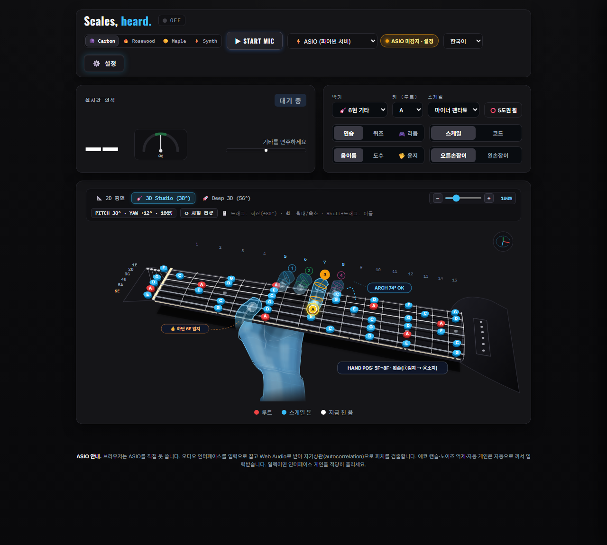
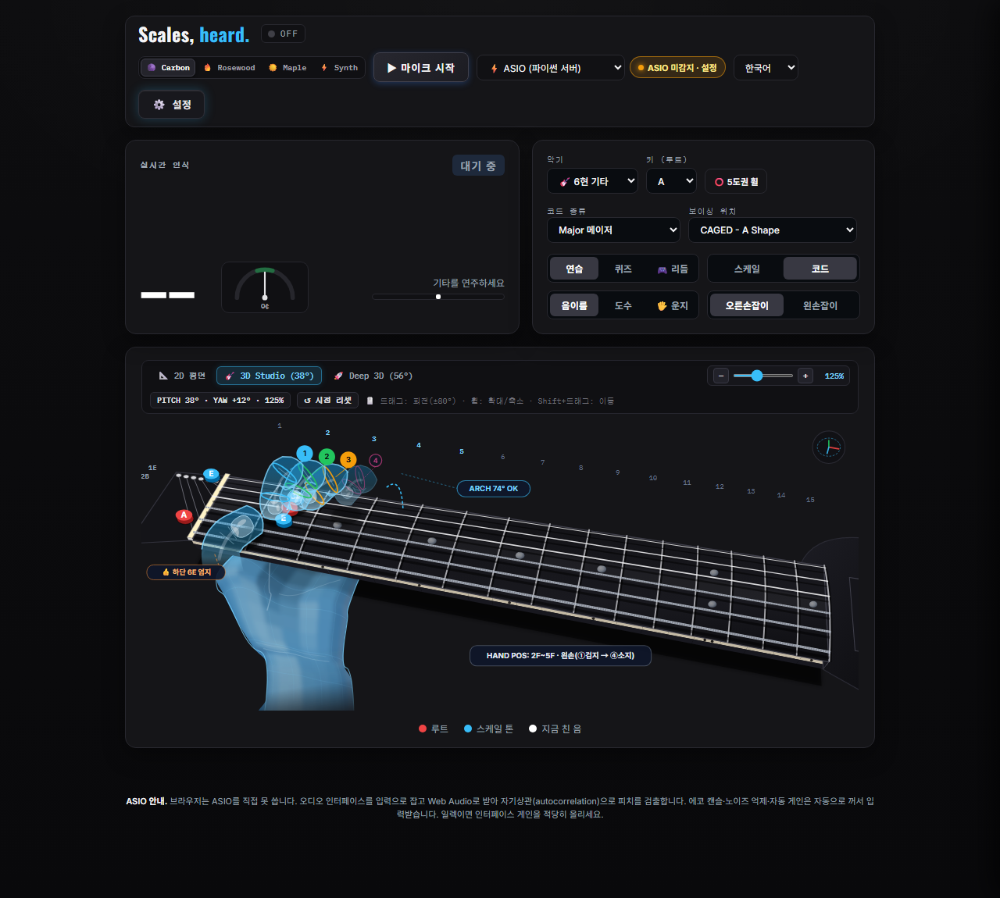
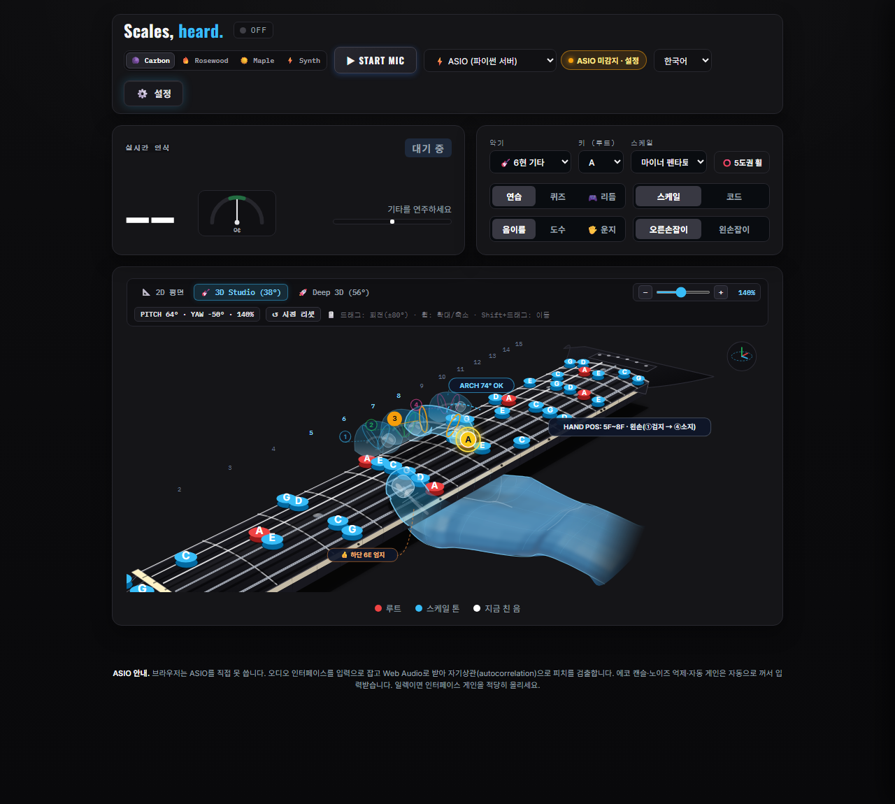
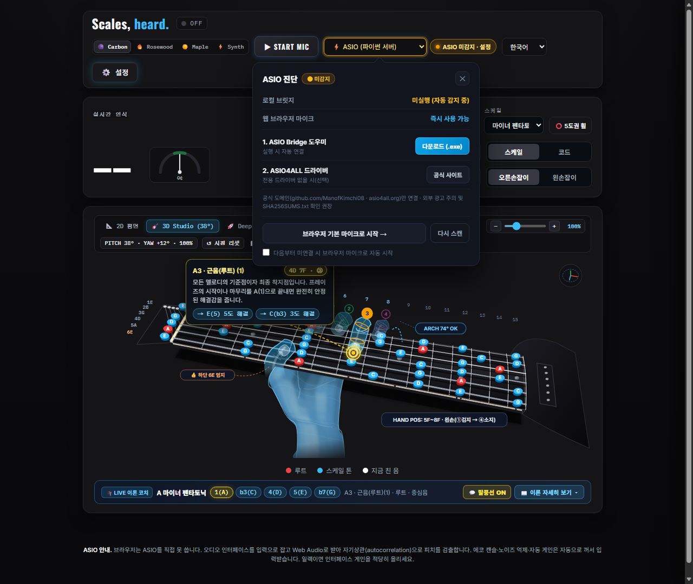
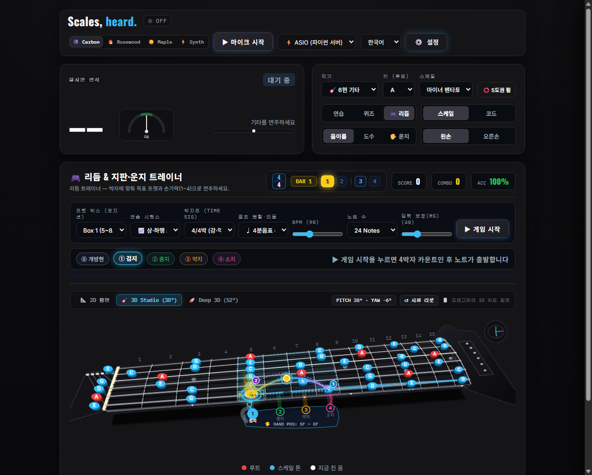
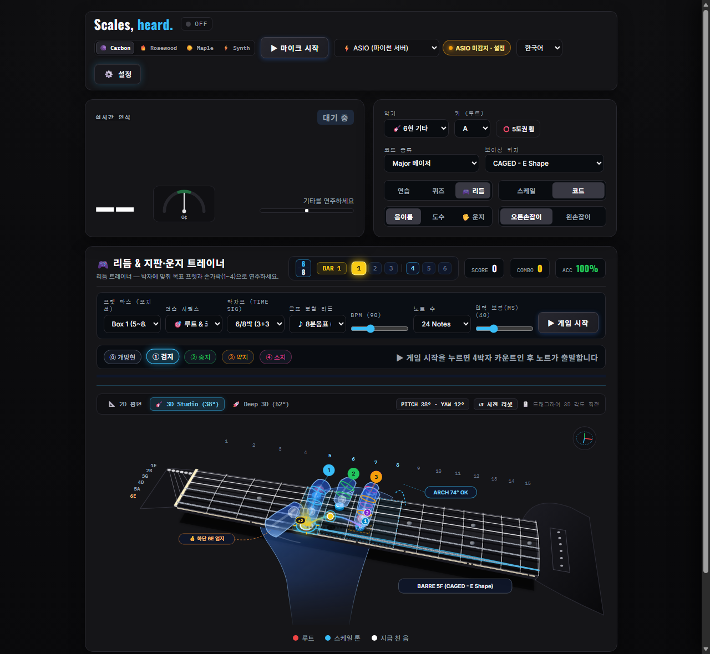

# Scales, heard. 🎸

**エレキギター＆ベースの実音をリアルタイムで聴き取る、超低遅延フレットボード・スケールガイド、リズムゲーム＆スマート運指トレーナー**

[](https://manofkimchi08.github.io/guitar-scale-tuner/)
[](https://github.com/ManofKimchi08/guitar-scale-tuner/releases)
[](LICENSE)
[](https://manofkimchi08.github.io/guitar-scale-tuner/)

> 🌐 **ブラウザで今すぐ試す (インストール不要)**: **[https://manofkimchi08.github.io/guitar-scale-tuner/](https://manofkimchi08.github.io/guitar-scale-tuner/)**  
> 🗣️ **Language / 언어 / 言語**: **[🇺🇸 English](README.md)** | **[🇰🇷 한국어](README.ko.md)** | **[🇯🇵 日本語](README.ja.md)**

---

## 📸 スクリーンショット & UIツアー (Screenshots)

| 🖐️ 半透明スカイブルー3D左手・未使用指の浮遊待機 (`38° · 100%`) | 🎼 オープン `A Major` ①②③分散＆④小指浮遊ポーズ (`38° · 125%`) |
| :---: | :---: |
|  |  |

| 🎥 広角3D回転 & 140%拡大 (`PITCH 64° · YAW -50° · 140%`) | ⚡ ハイブリッド 2+4 スマート ASIO 診断ドック |
| :---: | :---: |
|  |  |

| 🎮 リズム＆指板・運指トレーナー (`3Dレーザーハイウェイ` + 左手モデル) | 🖐️ `6/8拍子` 複合拍子ハイウェイ + CAGEDバレーコード(`BARRE 5F`) ガイド |
| :---: | :---: |
|  |  |

| 🎸 4弦ベースギター (1-5-8 グルーヴガイド) | 🎙️ 3-Tier レコーディングスタジオ & 指板シンクロ再生 |
| :---: | :---: |
|  |  |

---

## 🌟 主な機能 (v2.5.1)

### 0-B. 🖐️ 半透明スカイブルー3D立体手のひら・未使用指の浮遊待機ポーズ＆コード分散 (v2.5.1 新機能)
- **3D立体パラメトリック手のひら・手首 (`2+4ハイブリッド` 半透明スカイブルー)**: 平面的だった2D手のひらシルエットを `22×20` 3Dロフトメッシュ (`evalPalmPoint`) に刷新し、母指球(Thenar)・小指球(Hypothenar)・掌中央のくぼみ、Blinn-Phong/Fresnel/SSSシェーディング、および `#thumbBlendMask` による親指付け根の自然な接続を実現しました。
- **未使用指の指板上浮遊待機ポーズ**: 使わない指を非表示にせず4本すべて残したまま `1E..2B` 上方 (`wz3 = 21.0`) へ軽く浮かせ、柔らかい透明度 (`opacity 0.58` vs 押弦 `0.95`)・破線アウトラインバッジ・広く薄い浮遊影 (`dx = ±5, dy = 11`) によって押弦指と待機指を立体的に区別できます。
- **同一フレット・コード指分散＆バッジ重なり解消**: オープン `A Major` (`2F` ①②③) やバレー `E Shape` (`7F` ③④) のように同一フレットへ並ぶ指を扇状に分散し、未使用指を隣接する押弦指の横(`~3F`)へ自然に寄せ、上部 ①②③④ バッジを最小 `24px` 間隔で整理しました。

### 0-A. 🔍 広角3Dカメラ回転・拡大縮小(Zoom)＆視点移動(Pan) (v2.5.0 新機能)
- **拡張された3D回転可動域**: **`Yaw ±80°`**・**`Pitch -35° ~ +78°`** まで自在に回転でき、連続投影(`camDist = 920`)により45°付近の段差なく裏側見上げから俯瞰角度まで滑らかに確認できます。
- **カーソル基準 50% ~ 250% ズーム**: ツールバー (`−` / スライダー / `+`) または **マウスホイール** でカーソル位置を中心に拡大・縮小でき、弦・フレットの太さもズーム率に応じて自動補正されます。
- **`Shift + ドラッグ` パン移動 & リセット**: 拡大中に `Shift+左ドラッグ` (または中/右ドラッグ) で見たいポジションへ移動し、`↺ 시점 리셋` ボタンで回転・倍率(100%)・位置を一括リセットできます。(`Deep 3D` プリセット `56° / 115%` 搭載)

### 0. 🖐️ 3D IKアーチ型・左手運指コーチ (`IK Arch Coach Lab`)＆プレイヤー視点対応 (v2.4.0)
- **実演奏に即した左手視点 (`左ヘッド 1F → 右ボディ 15F` / `上 1E → 下 6E`)**: 右利きプレイヤーが見下ろす向きと同一の構図 (`PITCH 38° · YAW +12°`) を採用。左ヘッド側 `1E..6E` ラベル、下端 `6E` クリームバインディング＆サイドドット、上側 `1E` から下に曲げて押さえる4本の指(`① 人差し指 → ④ 小指`)、下側 `6E` から上に添える親指と自然フェード手首を立体描画します。
- **3D Catmull-Rom パラメトリックチューブ＆解剖学的関節ディテール**: 半透明コバルトブルーの3Dチューブ (`#coachDigit`)、指ごとのカラー **PIP/DIP 関節リング**、爪・半月、発光ターゲットパック (`#glowYellowHand`)、そして動的 `#forearmFadeMask` による手首のフェード処理で音名視認性と立体感を両立しました。
- **コーチングHUD＆自動追従スケーリング**: 上段フレット数字レール(`1..15`)、指番号バッジ(`① ② ③ ④`)、**`ARCH 74° OK`** フォームガイド、**`👍 하단 6E 엄지`** ラベル、**`HAND POS` / `BARRE`** ドックを備え、通常練習・ホバー・リズムゲーム・CAGEDバレーコード・マイク入力にリアルタイム連動します。
- **直感的な `右利き / 左利き` トグル**: 設定ボタン表記を `右利き / 左利き` (`Right-Handed / Left-Handed`) へ整理し、切替時に3DカメラYaw角と手・指板の左右ミラーリングを自動同期します。

### 1. 🧊 3Dスタジオ指板＆ハイブリッド 2+4 スマートASIOドック (v2.3.0)
- **実物ギターと同じ 12-TET フレット比率 ($2^{-n/12}$)**: 1フレットから22フレットまで平均律スケール公式に従って間隔が自然に狭まり、実機に近い視認性を実現しました。
- **インタラクティブ3D回転＆4種ネックテーマ**: **`2D平面`**・**`3D Studio (38°)`**・**`Deep 3D (52°)`** の切り替え、ドラッグによるPitch/Yaw角度回転、ワンクリック視点リセット、右上 **3D軸ギズモ**、立体3Dノートパックと4種ネックテーマ(`Carbon`, `Rosewood`, `Maple`, `Synth`)を備えています。
- **インストール不要のライブWeb版＆自動フォールバック**: [https://manofkimchi08.github.io/guitar-scale-tuner/](https://manofkimchi08.github.io/guitar-scale-tuner/) へアクセスすると、ローカルブリッジ未検出時は自動でブラウザ標準マイク (`mic_default`) に切り替わり、即座に演奏を始められます。
- **インライン ASIO 診断ポップオーバー**: `⚡ ASIO` を選択またはステータスバッジをクリックすると、**3ノード信号接続フロー**、**1.5秒バックグラウンド自動検出レーダー**、**2段階インストール案内**、ワンクリックのブラウザマイク切替ボタンが表示されます。
- **セキュリティ＆ローカルブリッジ分離 (Security Hardening)**:
  - **WebSocket Origin ホワイトリスト (CSWSH防御)**: `ws://127.0.0.1:8765` は `localhost` / `127.0.0.1` / `https://manofkimchi08.github.io` からの接続のみを許可し、不正な外部サイトからの接続を拒否(HTTP 403)します。
  - **ループバック限定＆堅牢化**: すべてのローカルサーバーを `127.0.0.1` に限定バインドし、`os.path.realpath` + `commonpath` によるシンボリックリンク/ディレクトリトラバーサル防止、`math.isfinite()` 数値検証、`textContent` XSS対策、`Content-Security-Policy` (CSP) ヘッダーを適用しました。

### 1. 🎮 リズム＆指板・運指トレーナー (`Rhythm & Fretboard Hero`)
- **60fps 6弦/4弦ノートハイウェイ(Note Highway)**: Web Audio APIのハードウェアクロック(`audioCtx.currentTime`)に完全同期した水平スクロールTABハイウェイと、下部SVG指板上の収縮アプローチリング(Approach Ring)がリアルタイムに連動します。
- **7種類の拍子記号 (`拍子記号 Time Signature`) に対応**:
  - **単純拍子・複合拍子・変拍子**: **4/4拍子**(`強・弱・中強・弱`)、**3/4拍子**(`強・弱・弱` ワルツ)、**6/8拍子**(`[3+3]` 複合2拍子)、**12/8拍子**(`[3+3+3+3]` スローロック・ブルース)、**2/4拍子**(`強・弱`)、**5/4拍子**(`[3+2]` 変拍子)、**7/8拍子**(`[2+2+3]` 変拍子)を搭載。
  - **3段階のメトロノーム強拍アクセント**: **強拍(`1320Hz`)**、**中強拍(`980Hz` — `6/8`の4拍目、`12/8`の4・7・10拍目など)**、**弱拍(`740Hz`)**を異なるピッチと音量で鳴らし分けます。
  - **拍子エンブレム＆小節グリッド**: ハイウェイ左上に現在の拍子記号(`4/4`, `3/4`, `6/8`, `12/8`)を表示し、小節線(`BAR 1, 2...`)とシアン色の点線(中強拍ガイド)を描画します。
- **11種類の音符分割＆リズムグルーヴ (`音符分割・リズム`)**:
  - `♩ 4分音符`、`♪ 8分音符`、`🎶 8分三連符(Triplet)`、`♬ 16分音符`、`🎷 ブルースシャッフル(Swing 2:1)`、`🎯 付点リズム(付点8分+16分)`、`🐎 メタルギャロップ(8分+16分×2)`、`🏇 リバースギャロップ`、`💃 トレシージョ(3+3+2)`、`🕺 16ビートファンク`、`🎸 ロックリフ`を内蔵。
- **リアルタイムタイミング判定＆詳細スコアカード**:
  - ギターの実音ピッチと打鍵タイミングを同時判定し、**`PERFECT` (`±45ms`)**、**`GREAT` (`±90ms`)**、**`GOOD` (`±145ms`)**、**`MISS`** および早遅ズレ(`EARLY / LATE ms`)をリアルタイム表示。
  - オーディオインターフェースの入力遅延補正スライダー(`0 ~ 150ms`)や、終了後の**総合ランク(`S / A / B / C`)**、**最大コンボ**、**苦手フレット・運指の弱点分析レポート**を提供します。

### 2. 🖐️ ハイブリッド指板運指ハンドアバター (`Hybrid Fretboard Hand Avatar`)
- **人間工学に基づく左手運指エンジンの自動計算 (`⓪ 開放弦`, `① 人差し指`, `② 中指`, `③ 薬指`, `④ 小指`)**:
  - オープンポジション(`0~4F`)、CAGED Box 1〜3(`1フレット1フィンガー`原則および3-Notes-Per-String `1-2-4` / `1-3-4` ストレッチ)、ハイポジション(`12~15F`)、さらに**CAGEDオープン＆バレーコード・ボイシング**の最適運指を自動算出します。
- **音名ラベルを一切隠さない2層(2-Layer) SVGハンドグラフィックス**:
  - **背面レイヤー (ノート円の下)**: ポジション移動時に滑らかにスライドする**半透明の掌＆親指シルエット(`🖐️ HAND POS: 5F ~ 8F`)**、指ごとの色分け**ナックルソケット(`1 人差し指` シアン・`2 中指` グリーン・`3 薬指` オレンジ・`4 小指` ピンク)**、**2関節フィンガーボーン(`基節骨 → PIP関節 → 末節骨`)**をノートの下層に描画し、音名・度数・指番号の視認性を100%保ちます。
  - **前面レイヤー (ノート円の上)**: 押弦フレット上の**指先パッド＆白い爪の半月**、次の音(`NEXT`)を予告する**半透明点線フィンガー＆曲線移動軌跡アーク**、そしてバレーコード演奏時に複数弦を制覇する**人差し指セーハバー(`🖐️ BARRE`)**を描画します。
  - **通常練習・クイズモードでのマウスホバー連動**: リズムゲーム以外の通常モードでも、`🖐️ 運指`トグルをONにするか指板上のノートにマウスを重ねるだけで、そのフレットやコードを押さえる手の形を即座に確認できます。

### 3. 🎸 6弦ギター & 4弦ベース完全対応
- **デュアル楽器エンジン**: `🎸 6弦ギター` と `🎸 4弦ベース` をワンクリックで切り替え可能。
- **30.0Hz サブベース検出**: 4096サンプルFFTとYIN + NNLS低域照合により、ベースのE1(41.2Hz)、Drop D(36.7Hz)、5弦Low B0(30.87Hz)まで高精度に検出します。
- **1-5-8 ベースグルーヴガイド**: ベースラインの要となるルート(1度)・5度・オクターブ(8度)をアンバーリングで強調表示します。

### 4. 🎙️ 3-Tier レコーディングスタジオ & 指板シンクロリプレイ
- **Tier 1 (ブラウザ即時録音)**: ギター音とバッキングトラック・メトロノームを同時ミックス録音し、16-bitロスレス `.wav` として即座に書き出し可能。
- **Tier 2 (ASIOスタジオ・ロスレス録音)**: Python ASIOバックエンドから `~/Music/GuitarScaleTuner/recordings/` へ16-bit PCM WAVを直接ストリーミング保存。
- **Tier 3 (スマート演奏分析 & シンクロ再生)**: 総ノート数、スケール的中率(%)、ピッチ安定度(%)を自動採点し、録音音声と当時の指板運指アニメーションを完全同期してリプレイします。

### 5. 🎛️ 適応型サンプルレート交渉 & 多言語サポート
- **自動サンプルレート交渉 (`PaErrorCode -9997` 完全解消)**: Windows WASAPI、ASIO、DirectSound、USBオーディオインターフェースのネイティブサンプルレート(`48000Hz`, `44100Hz`, `96000Hz`など)を自動検出し、DSP行列を動的に再計算します。
- **3ヶ国語完全対応**: 韓国語(KR)・英語(EN)・日本語(JP)のUIをリアルタイムに切り替えられます。

---

## 🚀 クイックスタート (Quick Start)

### 🌐 方法 0: インストール不要のライブWeb版 (最も手軽)
1. Chrome または Edge で **[https://manofkimchi08.github.io/guitar-scale-tuner/](https://manofkimchi08.github.io/guitar-scale-tuner/)** にアクセスします。
2. インストール不要で **`▶ マイク開始`** を押すだけで、PCマイクやUSBオーディオインターフェースを使って3D指板・リズムトレーナー・チューナーをすぐ利用できます。
3. **ハイブリッドASIOブリッジモード (任意)**: 上部ドロップダウンから **`⚡ ASIO`** を選ぶと、PC上のローカルASIOブリッジ(`127.0.0.1:8765`)を自動診断します。未導入の場合はスマート診断ポップオーバーが表示され、超低遅延ブリッジ(`.exe`)を導入するか、ワンクリックでブラウザ標準マイクへ切り替えてすぐ演奏できます。

### 方法 A: Windows ローカル実行ファイル
1. [Releasesページ](https://github.com/ManofKimchi08/guitar-scale-tuner/releases)から最新の `GuitarScaleTuner-v2.5.1-windows-x64.zip` をダウンロードして解凍するか、リポジトリをクローンします。
2. フォルダ内の **`GuitarScaleTuner.exe`** (または `Run_GuitarScaleTuner.bat`) をダブルクリックするだけで、Pythonのインストールなしで即座に起動します。

### 方法 B: ソースコードから実行
```bash
git clone https://github.com/ManofKimchi08/guitar-scale-tuner.git
cd guitar-scale-tuner
pip install -r requirements.txt
python GuitarScaleTuner.py
```

---

## 📖 技術ドキュメント (Technical Documentation)
DSPアルゴリズム、YIN基本周波数追跡、Coordinate Descent NNLSクロマソルバー、およびシステムアーキテクチャの詳細は以下をご覧ください:
👉 **[docs/TECHNICAL_DOCUMENTATION.md](docs/TECHNICAL_DOCUMENTATION.md)** | **[CHANGELOG.md](CHANGELOG.md)**

---

## 📄 ライセンス (License)
本プロジェクトは [MIT](LICENSE) ライセンスの下で公開されています。
