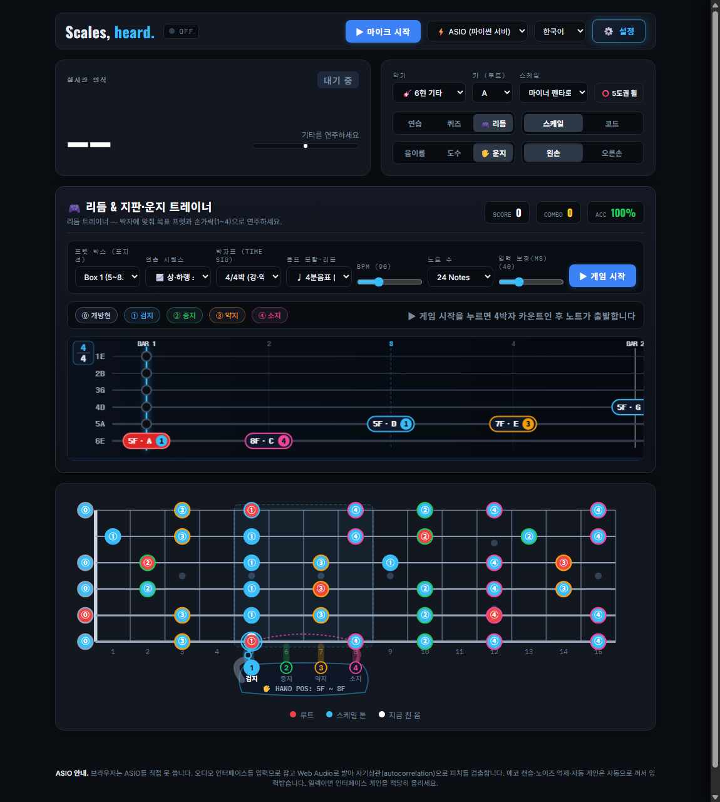
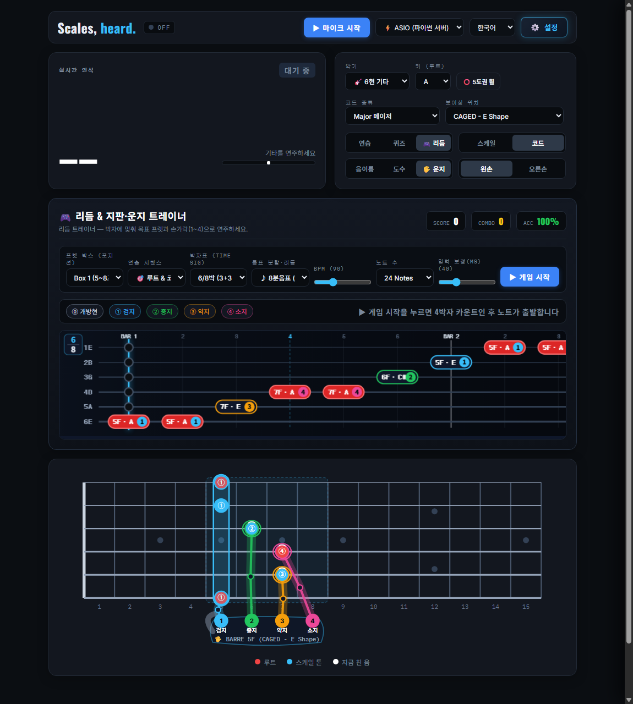

# Scales, heard. 🎸

**실제 일렉트릭 기타와 베이스 기타 소리를 실시간으로 듣고 반응하는 초저지연 지판 스케일 가이드, 리듬 게임 & 스마트 운지 트레이너**

[](https://github.com/ManofKimchi08/guitar-scale-tuner/releases)
[](LICENSE)
[]()

> 🌐 **Language / 언어 / 言語**: **[🇺🇸 English](README.md)** | **[🇰🇷 한국어](README.ko.md)** | **[🇯🇵 日本語](README.ja.md)**

---

## 📸 주요 화면 미리보기 (Screenshots & UI Tour)

| 🎮 리듬 & 지판·운지 트레이너 (`4/4박` 스케일 런 + 하이브리드 왼손 아바타) | 🖐️ `6/8박` 겹박자 하이웨이 + CAGED 바레 코드(`1 BARRE`) 손 가이드 |
| :---: | :---: |
|  |  |

| 🎸 6현 기타 지판 & 실시간 피치 HUD | 🎸 4현 베이스 기타 (1-5-8 그루브 가이드) | 🎙️ 3-Tier 레코딩 스튜디오 & 지판 싱크 복기 |
| :---: | :---: | :---: |
|  |  |  |

---

## 🌟 핵심 기능 소개 (v2.2.0)

### 1. 🎮 리듬 & 지판·운지 트레이너 (`Rhythm & Fretboard Hero`)
- **60fps 6현/4현 노트 하이웨이(Note Highway)**: Web Audio API 하드웨어 클럭(`audioCtx.currentTime`)에 동기화되어 드리프트 없이 스크롤되는 수평 타브(TAB) 하이웨이와 하단 SVG 지판의 수축 어프로치 링(Approach Ring)이 실시간 연동됩니다.
- **7종 박자표(`박자표 Time Signature`) 완벽 지원**:
  - **홑박자·겹박자·변박자**: **4/4박**(`강-약-중강-약`), **3/4박**(`강-약-약` 왈츠), **6/8박**(`[3+3]` 겹두박자), **12/8박**(`[3+3+3+3]` 슬로우 록·블루스), **2/4박**(`강-약`), **5/4박**(`[3+2]` 변박자), **7/8박**(`[2+2+3]` 변박자) 탑재.
  - **3단계 메트로놈 강세음**: **강박(`1320Hz`)**, **중강박(`980Hz` — `6/8`의 4번째 박, `12/8`의 4·7·10번째 박 등)**, **약박(`740Hz`)**이 서로 다른 주파수와 볼륨으로 출력됩니다.
  - **박자표 엠블럼 & 마디 그리드**: 하이웨이 좌측 상단에 박자표(`4/4`, `3/4`, `6/8`, `12/8`)가 표시되며, 마디 실선(`BAR 1, 2...`)과 중강박 점선 가이드라인이 함께 스크롤됩니다.
- **11종 음표 분할 및 장르별 리듬 그루브 (`음표 분할·리듬`)**:
  - `♩ 4분음표`, `♪ 8분음표`, `🎶 8분 셋잇단음표(Triplet)`, `♬ 16분음표`, `🎷 블루스 셔플(Swing 2:1)`, `🎯 부점 리듬(점8분+16분)`, `🐎 메탈 갤럽(8분+16분×2)`, `🏇 리버스 갤럽`, `💃 트레시요(3+3+2)`, `🕺 16비트 펑크`, `🎸 록 리프` 지원.
- **실시간 타이밍 판정 & 상세 결과 리포트**:
  - 실제 기타 피치와 타이밍을 동시에 채점하여 **`PERFECT` (`±45ms`)**, **`GREAT` (`±90ms`)**, **`GOOD` (`±145ms`)**, **`MISS`** 판정 및 빠름/느림(`EARLY / LATE ms`) 오차를 표시합니다.
  - 오디오 인터페이스 지연 보정 슬라이더(`0 ~ 150ms`) 및 세션 종료 후 **종합 랭크(`S / A / B / C`)**, **최대 콤보**, **취약 프렛·손가락 약점 분석 리포트**를 제공합니다.

### 2. 🖐️ 하이브리드 지판 운지 손 아바타 & 스마트 운지 엔진 (`Hybrid Fretboard Hand Avatar`)
- **인체공학적 왼손 운지 번호 자동 계산 (`⓪ 개방현`, `① 검지`, `② 중지`, `③ 약지`, `④ 소지`)**:
  - 오픈 포지션(`0~4F`), CAGED Box 1~3(`1프렛 1손가락` 원칙 및 3-Notes-Per-String `1-2-4` / `1-3-4` 스트레치), 하이 포지션(`12~15F`), 그리고 **CAGED 오픈·바레 코드 보이싱**의 최적 손가락 번호를 자동 산출합니다.
- **노트 글자를 절대 가리지 않는 2겹(2-Layer) SVG 손 그래픽**:
  - **후면 레이어 (노트 서클 아래)**: 포지션 이동 시 부드럽게 슬라이딩하는 **반투명 손바닥 & 엄지 실루엣(`🖐️ HAND POS: 5F ~ 8F`)**, 손가락별 컬러 **너클 소켓(`1 검지` 하늘색 · `2 중지` 초록색 · `3 약지` 주황색 · `4 소지` 보라색)**, **2단 관절 손가락 뼈대(`근위지골 → PIP 관절 → 원위지골`)**를 노트 뒤쪽에 그려 음이름·도수·운지 숫자의 가독성을 100% 보장합니다.
  - **전면 레이어 (노트 서클 위)**: 타겟 프렛을 누르는 **손끝 지문 패드 & 흰색 손톱 반달**, 다음 노트(`NEXT`)를 예고하는 **반투명 점선 손가락 & 곡선 이동 궤적 화살표**, 그리고 바레 코드 연주 시 여러 줄을 동시에 잡는 **검지 통짜 바레 바(`🖐️ BARRE`)**를 표시합니다.
  - **일반 연습·퀴즈 모드 마우스 호버 연동**: 리듬 게임 중이 아니더라도 상단 `🖐️ 운지` 토글을 켜거나 지판 위 노트에 마우스를 올리면 해당 음이나 코드를 짚는 손 모양을 즉시 볼 수 있습니다.

### 3. 🎸 6현 일렉트릭/어쿠스틱 기타 & 4현 베이스 기타 완벽 지원
- **듀얼 악기 엔진**: 상단 드롭다운에서 `🎸 6현 기타`와 `🎸 4현 베이스`를 즉시 전환할 수 있습니다.
- **30.0Hz 서브베이스 피치 검출**: 4096 FFT 윈도우와 YIN + NNLS 저주파 교차 검증으로 베이스 E1(41.2Hz), 드롭 D(36.7Hz), 5현 로우 B0(30.87Hz)까지 정밀하게 추적합니다.
- **1-5-8 베이스 그루브 가이드**: 베이스 연주의 핵심인 루트(1도), 5도, 옥타브(8도) 자리를 앰버 링으로 강조합니다.

### 4. 🎙️ 3-Tier 레코딩 스튜디오 & 지판 싱크 복기(Replay)
- **Tier 1 (브라우저 즉석 녹음)**: 기타 원음과 백킹 트랙·메트로놈을 동시 믹싱 녹음하고 16-bit 무손실 `.wav`로 즉시 다운로드합니다.
- **Tier 2 (ASIO 스튜디오 무손실 녹음)**: 파이썬 ASIO 백엔드에서 `~/Music/GuitarScaleTuner/recordings/` 폴더로 16-bit PCM WAV를 직접 스트리밍 저장합니다.
- **Tier 3 (스마트 연주 성적표 & 싱크 복기)**: 총 연주 음 수, 스케일 적중률(%), 피치 안정도(%)를 자동 산출하고, 녹음된 오디오와 당시 지판 운지를 실시간 동기화하여 재생합니다.

### 5. 🎛️ 적응형 샘플레이트 협상 & 다국어 지원
- **샘플레이트 자동 협상 (`PaErrorCode -9997` 원천 방지)**: Windows WASAPI, ASIO, DirectSound, USB 오디오 인터페이스의 네이티브 샘플레이트(`48000Hz`, `44100Hz`, `96000Hz` 등)를 자동 감지하고 FFT/NNLS 행렬을 동적 재계산합니다.
- **3개 국어 완벽 지원**: 한국어(KR), 영어(EN), 일본어(JP) UI를 실시간으로 전환할 수 있습니다.

---

## 🚀 빠른 시작 (Quick Start)

### 방법 A: Windows 무설치 원클릭 실행 파일 (권장)
1. [Releases 페이지](https://github.com/ManofKimchi08/guitar-scale-tuner/releases)에서 최신 `GuitarScaleTuner-v2.2.0-windows-x64.zip` 파일을 다운로드하여 압축을 해제하거나 저장소를 클론합니다.
2. 폴더 안의 **`GuitarScaleTuner.exe`** (또는 `Run_GuitarScaleTuner.bat`)를 더블클릭하면 파이썬 설치 없이 즉시 실행됩니다.

### 방법 B: 파이썬 소스 코드로 실행
```bash
git clone https://github.com/ManofKimchi08/guitar-scale-tuner.git
cd guitar-scale-tuner
pip install -r requirements.txt
python GuitarScaleTuner.py
```

---

## 📖 심층 기술 문서 (Technical Documentation)
DSP 알고리즘, YIN 기본 주파수 추적, Coordinate Descent NNLS 크로마 솔버 및 전체 아키텍처 다이어그램은 아래 문서를 참고하세요:
👉 **[docs/TECHNICAL_DOCUMENTATION.md](docs/TECHNICAL_DOCUMENTATION.md)** | **[CHANGELOG.md](CHANGELOG.md)**

---

## 📄 라이선스 (License)
이 프로젝트는 [MIT](LICENSE) 라이선스에 따라 배포됩니다.
