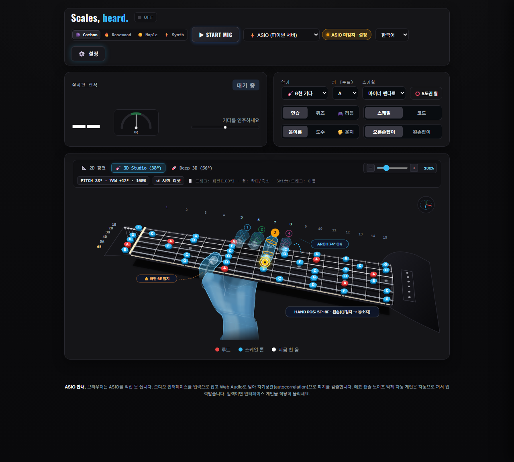
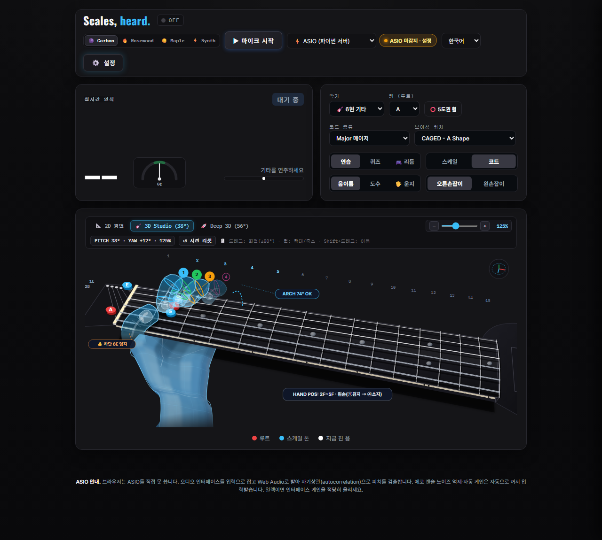
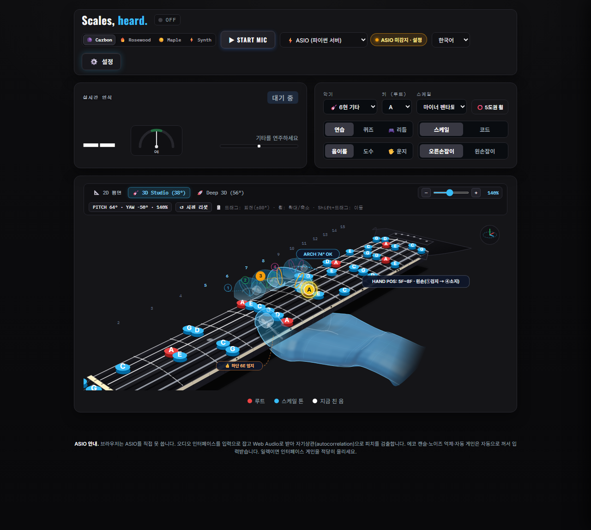
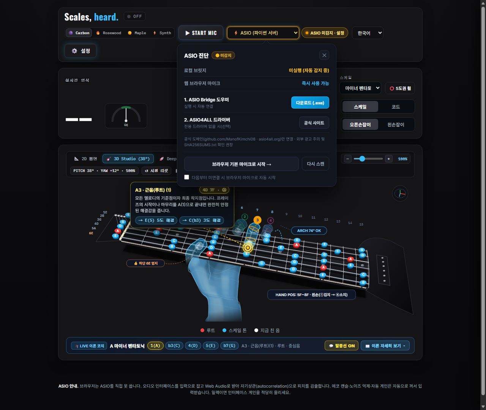
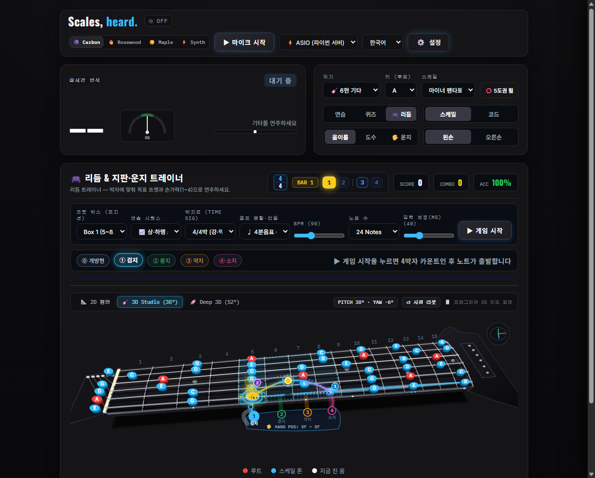
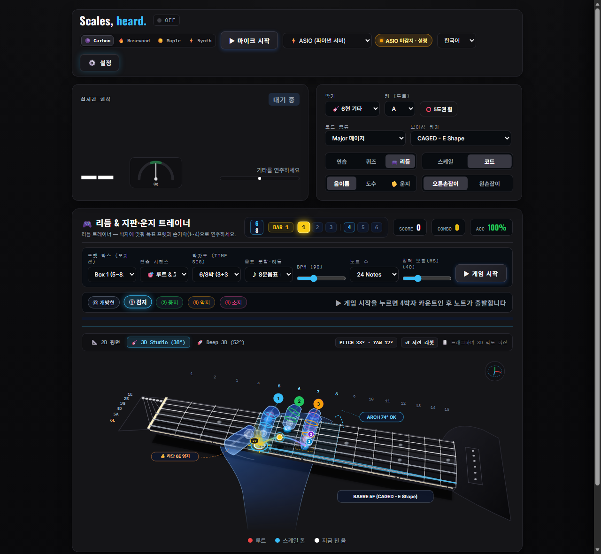

# Scales, heard. 🎸

**실제 일렉트릭 기타와 베이스 기타 소리를 실시간으로 듣고 반응하는 초저지연 지판 스케일 가이드, 리듬 게임 & 스마트 운지 트레이너**

[](https://manofkimchi08.github.io/guitar-scale-tuner/)
[](https://github.com/ManofKimchi08/guitar-scale-tuner/releases)
[](LICENSE)
[](https://manofkimchi08.github.io/guitar-scale-tuner/)

> 🌐 **웹에서 바로 실행 (설치 불필요)**: **[https://manofkimchi08.github.io/guitar-scale-tuner/](https://manofkimchi08.github.io/guitar-scale-tuner/)**  
> 🗣️ **Language / 언어 / 言語**: **[🇺🇸 English](README.md)** | **[🇰🇷 한국어](README.ko.md)** | **[🇯🇵 日本語](README.ja.md)**

---

## 📸 주요 화면 미리보기 (Screenshots & UI Tour)

| 🖐️ 반투명 하늘색 3D 입체 손바닥 & 미사용 손가락 부양 대기 뷰 (`38° · 100%`) | 🎼 오픈 `A Major` ①②③ 분리 & ④ 소지 부양 자세 (`38° · 125%`) |
| :---: | :---: |
|  |  |

| 🎥 광각 3D 회전 & 140% 확대 (`PITCH 64° · YAW -50° · 140%`) | ⚡ 하이브리드 2+4 스마트 ASIO 진단 & 3D 왼손 연동 |
| :---: | :---: |
|  |  |

| 🎮 리듬 & 지판·운지 트레이너 (`4/4박` + 3D 아치 왼손 코치) | 🖐️ `6/8박` 겹박자 하이웨이 + CAGED 바레 코드(`BARRE 5F`) 3D 손 가이드 |
| :---: | :---: |
|  |  |

| 🎸 4현 베이스 기타 (1-5-8 그루브 가이드) | 🎙️ 3-Tier 레코딩 스튜디오 & 지판 싱크 복기 |
| :---: | :---: |
|  |  |

---

## 🌟 핵심 기능 소개 (v2.5.1)

### 0-B. 🖐️ 반투명 하늘색 3D 입체 손바닥, 미사용 손가락 부양 대기 자세 & 코드 겹침 해소 (v2.5.1 신규)
- **3D 입체 파라메트릭 손바닥·손목 (`2+4 하이브리드` 반투명 하늘색)**: 평평한 2D 손바닥 실루엣을 `22×20` 3D 로프트 메시(`evalPalmPoint`)로 재구축하여 무지구(Thenar)·소지구(Hypothenar)·중앙 오목부 굴곡과 Blinn-Phong/Fresnel/SSS 셰이딩을 적용하고, `#thumbBlendMask`로 엄지 뿌리를 손바닥 안쪽에 자연스럽게 융합했습니다.
- **미사용 손가락 지판 위 살짝 든 대기 자세**: 사용하지 않는 손가락을 지우지 않고 4지 모두 유지한 채 `1E..2B` 상단 위(`wz3 = 21.0`)로 들어 올렸으며, 부드러운 반투명도(`opacity 0.58` vs 활성 `0.95`), 점선 아웃라인 뱃지, 지판 위로 넓고 옅게 이격된 공중 그림자(`dx = ±5, dy = 11`)로 누르는 손가락과 대기 손가락을 직관적으로 구분합니다.
- **동일 프렛 코드 부채꼴 분산 & ①②③④ 뱃지 이격**: 오픈 `A Major` (`2F` ①②③)나 바레 `E Shape` (`7F` ③④)처럼 같은 프렛에 모이는 손가락을 부채꼴로 분산하고, 미사용 손가락을 인접 활성 손가락 옆(`~3F`)에 정렬하며 상단 뱃지를 최소 `24px` 간격으로 이격했습니다.

### 0-A. 🔍 광각 3D 카메라 회전, 확대·축소(Zoom) & 이동(Pan) (v2.5.0 신규)
- **확장된 3D 오빗 회전 범위**: **`Yaw ±80°`**, **`Pitch -35° ~ +78°`** 까지 자유롭게 회전 가능하며 `camDist = 920` 연속 원근 투영으로 45° 경계 점프 없이 넥 하단부부터 상단 조감 뷰까지 매끄럽게 감상할 수 있습니다.
- **커서 중심 50% ~ 250% 확대·축소**: 상단 툴바(`−` / 슬라이더 / `+` / `%` 표시) 또는 **마우스 휠**로 원하는 프렛 위치를 중심으로 확대/축소하며, 배율에 따라 현·프렛 굵기도 비례 보정됩니다.
- **`Shift + 드래그` 시점 이동 & 원클릭 리셋**: 확대 상태에서 `Shift+좌클릭 드래그`(또는 휠 버튼/우클릭 드래그)로 프렛보드를 상하좌우 이동하고, `↺ 시점 리셋`으로 각도·배율·위치를 한 번에 초기화할 수 있습니다. (`Deep 3D` 프리셋 `56° / 115%` 지원)

### 0. 🖐️ 3D IK 아치 교정형 왼손 코치 (`IK Arch Coach Lab`) & 연주자 시점 정렬 (v2.4.0)
- **연주자 실제 1인칭 구도 (`좌측 헤드 1F → 우측 바디 15F`, `상단 1E → 하단 6E`)**: 오른손잡이 기타리스트가 실제 기타 넥을 내려다볼 때와 동일한 방향으로 정렬(`PITCH 38° · YAW +12°`)했으며, 상단 `1E` 너머에서 아래로 감아 내리는 4손가락(`① 검지 → ④ 소지`)과 하단 `6E` 크림 바인딩(`#dfd4bc` + 사이드 닷)을 넘어 위로 감아 올리는 엄지·페이드 손목을 입체 3D로 구현했습니다.
- **3D Catmull-Rom 파라메트릭 튜브 & 해부학적 관절 디테일**: 반투명 코발트 블루 손가락 튜브(`#coachDigit`) 위에 손가락별 컬러 **PIP/DIP 아치 관절 링**, 손톱과 흰색 반월(Lunula), 활성 타겟 황색 발광 퍽을 배치하고 `#fretboardHandBehindNeckLayer` + 동적 `#forearmFadeMask`로 지판 뒤 손바닥·손목이 부드럽게 사라지도록 설계해 음이름·도수 가독성과 입체감을 동시에 확보했습니다.
- **교육용 코칭 HUD & 자동 포지션 연동**: 상단 프렛 레일(`1..15`), **`① ② ③ ④`** 너클 배지, **`ARCH 74° OK`** 손가락 아치 가이드, **`👍 하단 6E 엄지`**, **`HAND POS` / `BARRE` 포지션 도크**를 제공하며, 기본 스케일 연습·마우스 호버·리듬 게임·CAGED 바레 코드·실시간 마이크 입력까지 3D 손 모델이 즉시 연동됩니다.
- **직관적인 `오른손잡이 / 왼손잡이` 설정 토글**: 설정 라벨을 연주자 기준(`오른손잡이 / 왼손잡이`)으로 통일하고, 전환 시 3D 카메라 Yaw 각도와 좌우 지판·손 자세를 대칭 미러링합니다.

### 1. 🧊 3D 스튜디오 지판 & 하이브리드 2+4 스마트 ASIO 진단 독 (v2.3.0)
- **실제 기타와 동일한 12-TET 프렛 비례 ($2^{-n/12}$)**: 1프렛부터 22프렛까지 실제 기타 물리 스케일 공식을 적용해 바디 쪽으로 갈수록 프렛 간격이 자연스럽게 좁아집니다.
- **인터랙티브 3D 원근 회전 & 4종 넥 테마**: **`2D 평면`**, **`3D Studio (38°)`**, **`Deep 3D (52°)`** 프리셋 전환, 드래그 Pitch/Yaw 회전, 원클릭 시점 리셋, 우측 상단 3D 축 기즈모와 입체 3D 노트 퍽(`Carbon`, `Rosewood`, `Maple`, `Synth`)을 지원합니다.
- **무설치 라이브 웹 배포 & 자동 폴백**: [https://manofkimchi08.github.io/guitar-scale-tuner/](https://manofkimchi08.github.io/guitar-scale-tuner/) 접속 시 로컬 ASIO 브릿지가 없으면 자동으로 브라우저 웹 마이크(`mic_default` · `웹 마이크 사용 중`)로 전환되어 즉시 연주할 수 있습니다.
- **하이브리드 2+4 인라인 ASIO 진단 팝오버**: `⚡ ASIO` 선택 또는 상태 배지 클릭 시 상단 바 직하단에 비차단 팝오버가 열리며, **3-노드 신호 흐름도**, **`1.5초` 백그라운드 자동 감지 레이더**, **2단계 설치 카드**(Bridge 도우미 `.exe`, ASIO4ALL), **원클릭 브라우저 마이크 전환 버튼**을 제공합니다.
- **보안 및 로컬 브릿지 격리 (Security Hardening)**:
  - **WebSocket Origin 화이트리스트 (CSWSH 방어)**: 로컬 `ws://127.0.0.1:8765` 연결을 `localhost`, `127.0.0.1`, 공식 웹 도메인(`https://manofkimchi08.github.io`)으로 엄격 제한해 타 외부 사이트의 로컬 접근을 차단합니다.
  - **루프백 전용 & 다중 방어**: 모든 로컬 서버를 `127.0.0.1`에만 바인딩하고, `os.path.realpath` + `commonpath` 심볼릭 링크/경로 탈출 차단, `math.isfinite()` 수치 검증, `textContent` 기반 XSS 방지, `Content-Security-Policy` 헤더를 적용했습니다.

### 1. 🎮 리듬 & 지판·운지 트레이너 (`Rhythm & Fretboard Hero`)
- **60fps 6현/4현 노트 하이웨이(Note Highway)**: Web Audio API 하드웨어 클럭(`audioCtx.currentTime`)에 동기화되어 드리프트 없이 스크롤되는 수평 타브(TAB) 하이웨이와 하단 SVG 지판의 수축 어프로치 링(Approach Ring)이 실시간 연동됩니다.
- **7종 박자표(`박자표 Time Signature`) 완벽 지원**:
  - **홑박자·겹박자·변박자**: **4/4박**(`강-약-중강-약`), **3/4박**(`강-약-약` 왈츠), **6/8박**(`[3+3]` 겹두박자), **12/8박**(`[3+3+3+3]` 슬로우 록·블루스), **2/4박**(`강-약`), **5/4박**(`[3+2]` 변박자), **7/8박**(`[2+2+3]` 변박자) 탑재.
  - **3단계 메트로놈 강세음**: **강박(`1320Hz`)**, **중강박(`980Hz` — `6/8`의 4번째 박, `12/8`의 4·7·10번째 박 등)**, **약박(`740Hz`)**이 서로 다른 주파수와 볼륨으로 출력됩니다.
  - **박자표 엠블럼 & 마디 그리드**: 하이웨이 좌측 상단에 박자표(`4/4`, `3/4`, `6/8`, `12/8`)가 표시되며, 마디 실선(`BAR 1, 2...`)과 중강박 점선 가이드라인이 함께 스크롤됩니다.
- **11종 음표 분할 및 장르별 리듬 그루브 (`음표 분할·리듬`)**:
  - `♩ 4분음표`, `♪ 8분음표`, `🎶 8분 셋잇단음표(Triplet)`, `♬ 16분음표`, `🎷 블루스 셔플(Swing 2:1)`, `🎯 부점 리듬(점8분+16분)`, `🐎 메탈 갤럽(8분+16분×2)`, `🏇 리버스 갤럽`, `💃 트레시요(3+3+2)`, `🕺 16비트 펑크`, `🎸 록 리프` 지원.
- **실시간 타이밍 판정 & 상세 결과 리포트**:
  - 실제 기타 피치와 타이밍을 동시에 채점하여 **`PERFECT` (`±45ms`)**, **`GREAT` (`±90ms`)**, **`GOOD` (`±145ms`)**, **`MISS`** 판정 및 빠름/느림(`EARLY / LATE ms`) 오차를 표시합니다.
  - 오디오 인터페이스 지연 보정 슬라이더(`0 ~ 150ms`) 및 세션 종료 후 **종합 랭크(`S / A / B / C`)**, **최대 콤보**, **취약 프렛·손가락 약점 분석 리포트**를 제공합니다.

### 2. 🖐️ 하이브리드 지판 운지 손 아바타 & 스마트 운지 엔진 (`Hybrid Fretboard Hand Avatar`)
- **인체공학적 왼손 운지 번호 자동 계산 (`⓪ 개방현`, `① 검지`, `② 중지`, `③ 약지`, `④ 소지`)**:
  - 오픈 포지션(`0~4F`), CAGED Box 1~3(`1프렛 1손가락` 원칙 및 3-Notes-Per-String `1-2-4` / `1-3-4` 스트레치), 하이 포지션(`12~15F`), 그리고 **CAGED 오픈·바레 코드 보이싱**의 최적 손가락 번호를 자동 산출합니다.
- **노트 글자를 절대 가리지 않는 2겹(2-Layer) SVG 손 그래픽**:
  - **후면 레이어 (노트 서클 아래)**: 포지션 이동 시 부드럽게 슬라이딩하는 **반투명 손바닥 & 엄지 실루엣(`🖐️ HAND POS: 5F ~ 8F`)**, 손가락별 컬러 **너클 소켓(`1 검지` 하늘색 · `2 중지` 초록색 · `3 약지` 주황색 · `4 소지` 보라색)**, **2단 관절 손가락 뼈대(`근위지골 → PIP 관절 → 원위지골`)**를 노트 뒤쪽에 그려 음이름·도수·운지 숫자의 가독성을 100% 보장합니다.
  - **전면 레이어 (노트 서클 위)**: 타겟 프렛을 누르는 **손끝 지문 패드 & 흰색 손톱 반달**, 다음 노트(`NEXT`)를 예고하는 **반투명 점선 손가락 & 곡선 이동 궤적 화살표**, 그리고 바레 코드 연주 시 여러 줄을 동시에 잡는 **검지 통짜 바레 바(`🖐️ BARRE`)**를 표시합니다.
  - **일반 연습·퀴즈 모드 마우스 호버 연동**: 리듬 게임 중이 아니더라도 상단 `🖐️ 운지` 토글을 켜거나 지판 위 노트에 마우스를 올리면 해당 음이나 코드를 짚는 손 모양을 즉시 볼 수 있습니다.

### 3. 🎸 6현 일렉트릭/어쿠스틱 기타 & 4현 베이스 기타 완벽 지원
- **듀얼 악기 엔진**: 상단 드롭다운에서 `🎸 6현 기타`와 `🎸 4현 베이스`를 즉시 전환할 수 있습니다.
- **30.0Hz 서브베이스 피치 검출**: 4096 FFT 윈도우와 YIN + NNLS 저주파 교차 검증으로 베이스 E1(41.2Hz), 드롭 D(36.7Hz), 5현 로우 B0(30.87Hz)까지 정밀하게 추적합니다.
- **1-5-8 베이스 그루브 가이드**: 베이스 연주의 핵심인 루트(1도), 5도, 옥타브(8도) 자리를 앰버 링으로 강조합니다.

### 4. 🎙️ 3-Tier 레코딩 스튜디오 & 지판 싱크 복기(Replay)
- **Tier 1 (브라우저 즉석 녹음)**: 기타 원음과 백킹 트랙·메트로놈을 동시 믹싱 녹음하고 16-bit 무손실 `.wav`로 즉시 다운로드합니다.
- **Tier 2 (ASIO 스튜디오 무손실 녹음)**: 파이썬 ASIO 백엔드에서 `~/Music/GuitarScaleTuner/recordings/` 폴더로 16-bit PCM WAV를 직접 스트리밍 저장합니다.
- **Tier 3 (스마트 연주 성적표 & 싱크 복기)**: 총 연주 음 수, 스케일 적중률(%), 피치 안정도(%)를 자동 산출하고, 녹음된 오디오와 당시 지판 운지를 실시간 동기화하여 재생합니다.

### 5. 🎛️ 적응형 샘플레이트 협상 & 다국어 지원
- **샘플레이트 자동 협상 (`PaErrorCode -9997` 원천 방지)**: Windows WASAPI, ASIO, DirectSound, USB 오디오 인터페이스의 네이티브 샘플레이트(`48000Hz`, `44100Hz`, `96000Hz` 등)를 자동 감지하고 FFT/NNLS 행렬을 동적 재계산합니다.
- **3개 국어 완벽 지원**: 한국어(KR), 영어(EN), 일본어(JP) UI를 실시간으로 전환할 수 있습니다.

---

## 🚀 빠른 시작 (Quick Start)

### 🌐 방법 0: 설치 없는 라이브 웹 버전 (가장 간편)
1. 크롬/엣지 브라우저로 **[https://manofkimchi08.github.io/guitar-scale-tuner/](https://manofkimchi08.github.io/guitar-scale-tuner/)** 주소에 접속합니다.
2. 별도 설치 없이 **`▶ 마이크 시작`**을 누르면 PC 마이크 또는 USB 오디오 인터페이스 입력으로 3D 지판, 리듬 트레이너, 튜너를 즉시 사용할 수 있습니다.
3. **하이브리드 ASIO 브릿지 모드 (선택)**: 상단 입력 장치에서 **`⚡ ASIO`**를 선택하면 내 PC의 로컬 ASIO 브릿지 실행 여부를 자동 진단합니다. 미설치 시 스마트 안내 팝오버가 열려 초저지연 브릿지(`.exe`)를 설치하거나 원클릭으로 브라우저 마이크로 전환해 연주할 수 있습니다.

### 방법 A: Windows 로컬 패키지 실행
1. [Releases 페이지](https://github.com/ManofKimchi08/guitar-scale-tuner/releases)에서 최신 `GuitarScaleTuner-v2.5.1-windows-x64.zip` 파일을 다운로드하여 압축을 해제하거나 저장소를 클론합니다.
2. 폴더 안의 **`GuitarScaleTuner.exe`** (또는 `Run_GuitarScaleTuner.bat`)를 더블클릭하면 파이썬 설치 없이 즉시 실행됩니다.

### 방법 B: 파이썬 소스 코드로 실행
```bash
git clone https://github.com/ManofKimchi08/guitar-scale-tuner.git
cd guitar-scale-tuner
pip install -r requirements.txt
python GuitarScaleTuner.py
```

---

## 📖 심층 기술 문서 (Technical Documentation)
DSP 알고리즘, YIN 기본 주파수 추적, Coordinate Descent NNLS 크로마 솔버 및 전체 아키텍처 다이어그램은 아래 문서를 참고하세요:
👉 **[docs/TECHNICAL_DOCUMENTATION.md](docs/TECHNICAL_DOCUMENTATION.md)** | **[CHANGELOG.md](CHANGELOG.md)**

---

## 📄 라이선스 (License)
이 프로젝트는 [MIT](LICENSE) 라이선스에 따라 배포됩니다.
