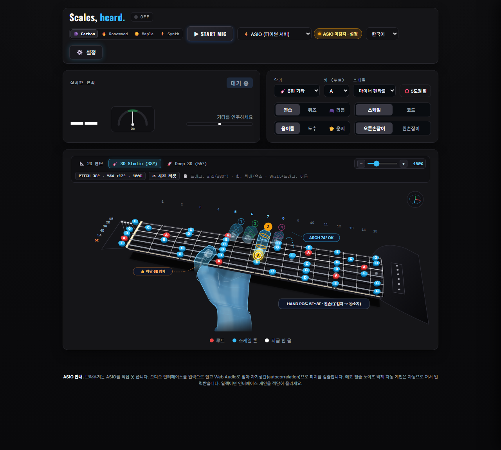
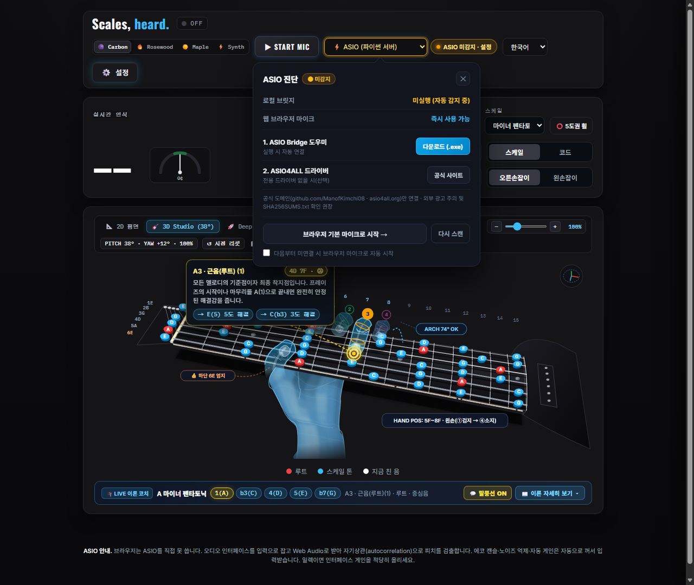
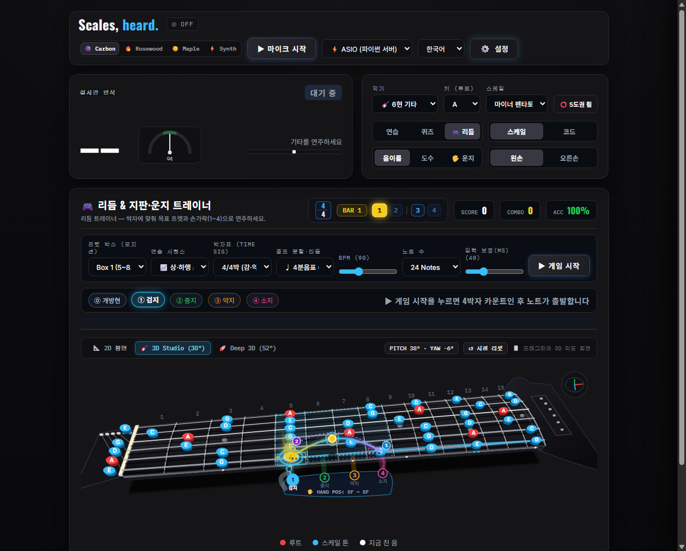
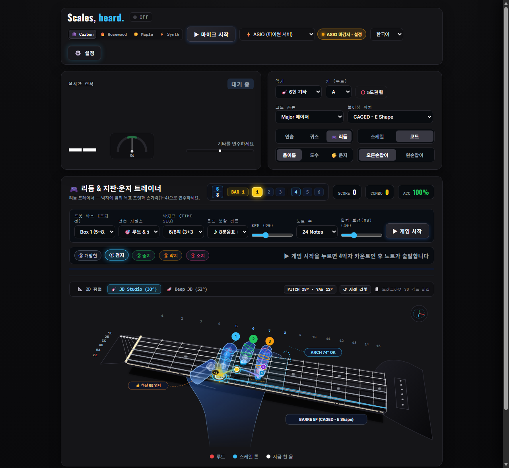

# Scales, heard. 🎸

A powerful, ultra low-latency fretboard **scale guide, rhythm game & ergonomic fingering trainer** in the browser and desktop that **listens to your real electric & bass guitar** in real-time.

[](https://manofkimchi08.github.io/guitar-scale-tuner/)
[](https://github.com/ManofKimchi08/guitar-scale-tuner/releases)
[](LICENSE)
[](https://manofkimchi08.github.io/guitar-scale-tuner/)

> 🌐 **Live Web App (No Install)**: **[https://manofkimchi08.github.io/guitar-scale-tuner/](https://manofkimchi08.github.io/guitar-scale-tuner/)**  
> 🗣️ **Language / 언어 / 言語**: **[🇺🇸 English](README.md)** | **[🇰🇷 한국어 전문 (Korean)](README.ko.md)** | **[🇯🇵 日本語全文 (Japanese)](README.ja.md)**  
> 🔽 **In-Page Quick Jump**: [🇺🇸 English](#-key-features-v240) · [🇰🇷 한국어 설명](#-한국어-설명-korean-overview) · [🇯🇵 日本語説明](#-日本語説明-japanese-overview)

---

## 📸 Screenshots & UI Tour

| 🖐️ 3D IK Arch Coach Left-Hand Avatar (`Box 1 · 5F~8F`) | ⚡ Hybrid 2+4 Smart ASIO Diagnostic & 3D Hand Preview |
| :---: | :---: |
|  |  |

| 🎮 Rhythm & Fretboard Trainer (`3D Laser Highway` + 3D Arched Hand) | 🖐️ 6/8 Time Signature + CAGED Barre Chord (`BARRE 5F`) 3D Hand |
| :---: | :---: |
|  |  |

| 🎸 4-String Bass Guitar (1-5-8 Groove Guide) | 🎙️ 3-Tier Recording Studio & Synced Replay |
| :---: | :---: |
|  |  |

---

## 🌟 Key Features (v2.4.0)

### 0. 🖐️ 3D IK Arch Coach Left-Hand Avatar (`IK Arch Coach Lab`) & Player Perspective (New in v2.4.0)
- **Authentic Player-Perspective 3D Orientation (`Headstock Left 1F → Body Right 15F`, `Top 1E → Bottom 6E`)**: Aligns naturally with how a right-handed guitarist looks down at their fretting hand (`PITCH 38° · YAW +12°`), combining a left headstock (`1E..6E` open string labels), realistic bottom `6E` cream binding with side dots, 4 arched fingers curling downward from above `1E` (`① Index → ④ Pinky`), and the thumb wrapping upward across `6E`.
- **3D Catmull-Rom Parametric Tubes & Anatomical Detail**: Translucent cobalt-blue 3D digit tubes (`#coachDigit`), color-coded **PIP/DIP arch joint rings**, fingernails + white lunula, glowing yellow target pucks (`#glowYellowHand`), and a dynamically faded wrist silhouette (`#fretboardHandBehindNeckLayer` + `#forearmFadeMask`) preserve complete fretboard note legibility while showing lifelike finger curvature.
- **Coaching HUD & Adaptive Scaling**: Displays elevated `1..15` fret numbers, top `① ② ③ ④` knuckle badges, the **`ARCH 74° OK`** posture callout, **`👍 하단 6E 엄지`** thumb anchor cue, and the **`HAND POS` / `BARRE`** dock, automatically scaling digit thickness across higher frets and reacting live to idle scale previews, hover, rhythm playback, CAGED barre voicings, and microphone input.
- **Clear `Right-Handed / Left-Handed` Toggle**: Refines hand selection labels to **`Right-Handed / Left-Handed`** (`오른손잡이 / 왼손잡이`, `右利き / 左利き`) and mirrors 3D yaw and finger orientation cues symmetrically when switched.

### 1. 🧊 3D Studio Fretboard & Hybrid 2+4 Smart ASIO Dock (v2.3.0)
- **Realistic 12-TET Fret Proportions ($2^{-n/12}$)**: Fret spacing accurately narrows down the neck toward the body following the physical 12-tone equal temperament formula.
- **Interactive 3D Perspective Modes**: Switch between **`2D Flat`**, **`3D Studio (38°)`**, and **`Deep 3D (52°)`**, drag to orbit **Pitch / Yaw** freely with live angle readouts, reset the camera in one click, and inspect orientation with the top-right **3D Axis Gizmo**.
- **3D Extruded Note Pucks & 4 Studio Neck Themes**: Combines an Antigravity dark carbon palette with tactile 3D shadowed pucks and **`Carbon`**, **`Rosewood`**, **`Maple`**, and **`Synth`** neck styles.
- **Zero-Install Web Deployment & Smart ASIO Fallback**: Opening the [Live Web App](https://manofkimchi08.github.io/guitar-scale-tuner/) over `https://` automatically switches to browser Web Audio mic input (`mic_default`) when no local bridge is active, so anyone can press **`▶ START MIC`** immediately without downloading anything.
- **Inline Hybrid 2+4 ASIO Setup Popover**: Selecting `⚡ ASIO` or clicking the status badge anchors a non-blocking popover right below the selector displaying:
  - A live **3-Node Signal Flow Diagram** (`Audio Interface → ASIO Bridge Helper → Web 3D Fretboard`).
  - A **`1.5s` background auto-detect radar** that connects automatically as soon as the local bridge launches.
  - **2-Step Installer Cards** (Bridge helper `.exe` & ASIO4ALL driver), a one-click **Switch to Browser Mic** button, and a remembered auto-fallback preference.
- **Security & Local Bridge Isolation**:
  - **WebSocket `Origin` Allowlist (CSWSH Defense)**: Local `ws://127.0.0.1:8765` strictly permits only `localhost`, `127.0.0.1`, and `https://manofkimchi08.github.io`, blocking unauthorized external websites (HTTP 403).
  - **Loopback-Only Binding & Hardening**: Binds all local servers strictly to `127.0.0.1`, enforces `os.path.realpath` + `commonpath` symlink/path traversal protection, validates numerical WebSocket controls with `math.isfinite()`, sanitizes UI text via `textContent`, and enforces a strict `Content-Security-Policy` (CSP) meta header.

### 1. 🎮 Rhythm & Fretboard Hero (`리듬 & 지판·운지 트레이너`)
- **60fps 6-String / 4-String Note Highway**: Scrolling horizontal string highway synchronized to the Web Audio API hardware clock (`audioCtx.currentTime`).
- **7 Musical Time Signatures (`박자표 Time Signature`)**:
  - **Simple & Compound Meters**: **4/4** (`Strong-Weak-Medium-Weak`), **3/4** (`Strong-Weak-Weak` Waltz), **6/8** (`[3+3]` Compound Duple), **12/8** (`[3+3+3+3]` Slow Rock / Blues), **2/4** (`Strong-Weak`), **5/4** (`[3+2]` Odd Meter), and **7/8** (`[2+2+3]` Odd Meter).
  - **3-Tier Metronome Accents**: Distinct Web Audio synthesized clicks for **Downbeat (`1320Hz`)**, **Sub-Accent (`980Hz` — e.g. beat 4 in `6/8`, beats 4·7·10 in `12/8`)**, and **Weak Beat (`740Hz`)**.
  - **Visual Bar & Sub-Beat Grid**: Displays a live Time Signature emblem (`4/4`, `3/4`, `6/8`, `12/8`), solid bar lines (`BAR 1, 2...`), and cyan dashed sub-accent lines (`3+3` in `6/8`, `3+3+3+3` in `12/8`).
- **11 Note Subdivisions & Groove Patterns**:
  - Quarter (`♩`), Eighth (`♪`), Eighth Triplet (`🎶`), Sixteenth (`♬`), Blues Shuffle (`🎷 2:1 Swing`), Dotted 8th+16th (`🎯`), Metal Gallop (`🐎`), Reverse Gallop (`🏇`), Tresillo (`💃 3+3+2`), 16-Beat Funk (`🕺`), and Classic Rock Riff (`🎸`).
- **Real-Time Pitch + Timing Judgement**:
  - Evaluates live guitar audio against target pitch class and hit timing windows: **`PERFECT` (`±45ms`)**, **`GREAT` (`±90ms`)**, **`GOOD` (`±145ms`)**, and **`MISS`**, with configurable **Input Latency Offset (`0 ~ 150ms`)**.
  - Generates an end-of-round **Rank (`S / A / B / C`)**, **Max Combo**, **Average Timing Offset (`ms` Early/Late)**, and **Weak-Spot Finger/Fret Analysis**.

### 2. 🖐️ Hybrid Fretboard Hand Avatar & Smart Fingering
- **Ergonomic Left-Hand Fingering Engine (`⓪ Open`, `① Index`, `② Middle`, `③ Ring`, `④ Pinky`)**:
  - Automatically computes optimal left-hand finger assignments across Open Position (`0~4F`), CAGED Boxes 1–3 (`1-finger-per-fret` & `3-Notes-Per-String` `1-2-4` / `1-3-4` stretches), High Position (`12~15F`), and **CAGED Open & Barre Chord Voicings**.
- **2-Layer Non-Occluding SVG Hand Avatar**:
  - **Back Layer (Under Note Circles)**: Renders a translucent **Ghost Palm & Thumb Silhouette (`🖐️ HAND POS: 5F ~ 8F`)** that smoothly glides along the neck, **4 color-coded Knuckle Sockets (`1 Cyan`, `2 Green`, `3 Orange`, `4 Pink`)**, and **2-Segment Articulated Finger Bones (`Proximal → PIP Joint → Distal`)** so note names, degrees, and finger numbers remain 100% legible.
  - **Tip Layer (Over Note Circles)**: Renders an anatomical **Fingertip Pad + White Nail Crescent** on the active fret, a **Dashed `NEXT` Ghost Finger & Curved Motion Trajectory Arc** previewing the upcoming note, and a full-height **Index Finger Barre Bar (`🖐️ BARRE`)** when playing CAGED barre chords.
  - **Interactive Hover Preview**: Works in both **Rhythm Game Mode** and standard **Practice / Quiz Modes** (hover over any fret or toggle `🖐️ Finger` to inspect how the hand grips that note or chord).

### 3. 🎸 6-String Guitar & 4-String Bass Support
- **Dual Instrument Engine**: Instant toggle between `🎸 6-String Guitar` and `🎸 4-String Bass`.
- **30.0Hz Sub-Bass Detection**: Extends pitch detection down to B0 (30.87Hz), Drop D (36.7Hz), and E1 (41.2Hz) with auto-switching 4096 FFT buffers and YIN + NNLS low-frequency reconciliation.
- **1-5-8 Groove Interval Guide**: Visual amber rings accent the Root (1st), 5th, and Octave (8th) positions essential for bassists.

### 4. 🎙️ 3-Tier Recording Studio & Smart Scorecard
- **Tier 1 (Instant Browser REC)**: One-click recording of guitar audio + backing tracks & metronome into a 16-bit lossless `.wav`.
- **Tier 2 (ASIO Studio Lossless)**: Direct 16-bit PCM WAV disk streaming to `~/Music/GuitarScaleTuner/recordings/ASIO_Take_*.wav`.
- **Tier 3 (Smart Analysis & Synced Replay)**: Automated performance scorecard (**Total Notes**, **Scale Accuracy %**, **Pitch Stability %**) with interactive **Synced Fretboard Replay**.

---

## 🇰🇷 한국어 설명 (Korean Overview)

> 📄 **전체 한국어 문서는 [README.ko.md](README.ko.md)에서도 보실 수 있습니다.**

**Scales, heard. (Guitar Scale Tuner v2.4.0)** 는 실제 일렉트릭 기타와 베이스 기타 소리를 실시간으로 인식하는 초저지연 **3D 지판 스케일 가이드, IK 아치 교정형 3D 왼손 운지 코치 & 리듬 게임 트레이너**입니다.

### ✨ v2.4.0 핵심 업데이트
1. **🖐️ 3D IK 아치 교정형 왼손 코치 (`IK Arch Coach Lab`)**: 좌측 헤드(`1F`, `1E..6E`) → 우측 바디(`15F`), 상단 `1E`에서 아래로 감아 내리는 3D Catmull-Rom 튜브 손가락(`①~④`, PIP/DIP 관절 링·손톱/반월 포함)과 하단 `6E` 크림 바인딩·엄지·동적 페이드 손목 실루엣, `ARCH 74° OK` & `HAND POS` 교육용 HUD를 탑재했습니다.
2. **🔄 직관적인 `오른손잡이 / 왼손잡이` 설정 & 원클릭 실행 패키지 최신화**: 연주자 기준 토글 라벨로 정비하고 전환 시 3D 카메라 Yaw와 손/지판 구도를 자동 미러링합니다.

### ✨ v2.3.0 핵심 업데이트
1. **🧊 3D 스튜디오 지판 & 실제 12-TET 프렛 비례 ($2^{-n/12}$)**: `2D 평면`, `3D Studio (38°)`, `Deep 3D (52°)` 시점, 드래그 Pitch/Yaw 회전과 3D 축 기즈모, 입체 3D 노트 퍽, 4종 넥 테마(`Carbon`, `Rosewood`, `Maple`, `Synth`)를 지원합니다.
2. **⚡ 무설치 웹 배포 & 하이브리드 2+4 스마트 ASIO 진단 독**: GitHub Pages(`https://manofkimchi08.github.io/guitar-scale-tuner/`) 접속 시 웹 마이크(`mic_default`)로 즉시 동작하며, `⚡ ASIO` 선택 시 3-노드 신호 흐름도, `1.5초` 백그라운드 레이더, 2단계 설치 안내 및 원클릭 웹 마이크 전환 팝오버를 제공합니다.
3. **🔒 보안 하드닝**: WebSocket `Origin` 화이트리스트(`localhost`, `127.0.0.1`, `https://manofkimchi08.github.io`) CSWSH 방어, 루프백 전용 바인딩, `realpath` 경로 탈출 차단, `math.isfinite()` 입력 검증 및 `Content-Security-Policy`를 적용했습니다.

### ✨ v2.2.0 주요 기능
1. **🎮 리듬 & 지판·운지 트레이너 (`Rhythm & Fretboard Hero`)**
   - **60fps 6현/4현 노트 하이웨이**: 상단 수평 타브 하이웨이에서 프렛 번호·음이름·추천 손가락 번호(`⓪~④`)가 결합된 캡슐 노트가 흐르고, 하단 지판의 목표 프렛에 타이밍 수축 링(Approach Ring)이 동기화됩니다.
   - **7종 박자표(`박자표 Time Signature`) 지원**: **4/4박**(`강-약-중강-약`), **3/4박**(`강-약-약` 왈츠), **6/8박**(`[3+3]` 겹두박자), **12/8박**(`[3+3+3+3]` 슬로우 록·블루스), **2/4박**, **5/4박(`3+2`)**, **7/8박(`2+2+3`)**과 **3단계 메트로놈 강세음(`강박 1320Hz`, `중강박 980Hz`, `약박 740Hz`)** 및 하이웨이 마디선·중강박 점선 가이드를 지원합니다.
   - **11종 음표 분할·리듬 패턴**: `4분음표`, `8분음표`, `8분 셋잇단음표`, `16분음표`, `블루스 셔플(2:1)`, `부점 리듬`, `메탈 갤럽`, `리버스 갤럽`, `트레시요(3+3+2)`, `16비트 펑크`, `록 리프` 내장.
   - **정밀 타이밍 판정 & 약점 리포트**: `PERFECT(±45ms)` / `GREAT(±90ms)` / `GOOD(±145ms)` / `MISS` 판정, 입력 지연 보정(`0~150ms`), 라운드 종료 후 `S/A/B/C` 랭크 및 취약 프렛·손가락 분석 제공.
2. **🖐️ 하이브리드 지판 운지 손 아바타 (`Hybrid Fretboard Hand Avatar`)**
   - **노트 글자를 가리지 않는 2겹 SVG 레이어**: 노트 원 아래쪽에는 **반투명 손바닥 & 엄지 실루엣(`🖐️ HAND POS: 5F ~ 8F`)**, 손가락별 컬러 **너클 소켓(`1 검지` 하늘색 · `2 중지` 초록색 · `3 약지` 주황색 · `4 소지` 보라색)**, **2단 관절 손가락 뼈대**를 배치하고, 노트 원 위쪽에는 **손끝 지문 패드 & 흰색 손톱 반달**, **다음 노트(`NEXT`) 점선 손가락 & 곡선 이동 궤적 호**를 렌더링합니다.
   - **CAGED 바레 코드(`🖐️ BARRE`) 전용 뷰**: 검지(`①`)로 여러 줄을 동시에 잡는 바레 코드 선택 시 검지 통짜 바레 바와 나머지 손가락 관절을 직관적으로 표시합니다.
   - **마우스 호버 즉시 미리보기**: 일반 연습/퀴즈 모드에서도 `🖐️ 운지` 토글을 켜거나 지판 위 노트에 마우스를 올리면 즉시 손 모양을 확인할 수 있습니다.
3. **🖥️ Windows 원클릭 실행**: 최상위 폴더의 `GuitarScaleTuner.exe` (또는 `Run_GuitarScaleTuner.bat`)를 더블클릭하면 파이썬 설치 없이 바로 실행됩니다.

---

## 🇯🇵 日本語説明 (Japanese Overview)

> 📄 **日本語の完全なドキュメントは [README.ja.md](README.ja.md) でもご覧いただけます。**

**Scales, heard. (Guitar Scale Tuner v2.4.0)** は、エレキギター＆ベースの実音をリアルタイムで聴き取る超低遅延の**3Dフレットボード・スケールガイド、3D IKアーチ運指コーチ＆リズムゲームトレーナー**です。

### ✨ v2.4.0 主なアップデート
1. **🖐️ 3D IKアーチ型・左手運指コーチ (`IK Arch Coach Lab`)**: 左ヘッド(`1F`, `1E..6E`) → 右ボディ(`15F`)の実演奏視点を忠実に再現。上側`1E`から下に曲げて押さえる3D Catmull-Romチューブ指(`①〜④`・PIP/DIP関節リング・爪/半月)と下側`6E`クリームバインディング・親指・フェード手首、`ARCH 74° OK`＆`HAND POS`コーチングHUDを搭載しました。
2. **🔄 直感的な `右利き / 左利き` 切替＆ワンクリックEXE最新化**: プレイヤー基準のラベルへ刷新し、切替時に3DカメラYaw角と左右ミラーリングを連動させました。

### ✨ v2.3.0 主なアップデート
1. **🧊 3Dスタジオ指板＆実物12-TETフレット比率 ($2^{-n/12}$)**: `2D平面`、`3D Studio (38°)`、`Deep 3D (52°)` 視点、ドラッグによるPitch/Yaw回転と3D軸ギズモ、立体3Dノートパック、4種のネックテーマ(`Carbon`, `Rosewood`, `Maple`, `Synth`)を搭載しました。
2. **⚡ インストール不要のWeb版＆ハイブリッド2+4スマートASIO診断ドック**: GitHub Pages (`https://manofkimchi08.github.io/guitar-scale-tuner/`) へアクセスするとブラウザ標準マイク (`mic_default`) へ自動切替し、`⚡ ASIO` 選択時は3ノード信号フロー、1.5秒自動検出レーダー、2ステップ導入ガイドを表示します。
3. **🔒 セキュリティ強化**: WebSocket `Origin` ホワイトリスト (`localhost`, `127.0.0.1`, `https://manofkimchi08.github.io`) によるCSWSH対策、ループバック限定バインド、`realpath` パストラバーサル防止、`math.isfinite()` 検証、およびCSPヘッダーを適用しています。

### ✨ v2.2.0 主な機能
1. **🎮 リズム＆指板・運指トレーナー (`Rhythm & Fretboard Hero`)**
   - **60fps 6弦/4弦ノートハイウェイ**: 水平スクロールするTABハイウェイにフレット番号・音名・推奨指番号(`⓪〜④`)のカプセルノートが流れ、下部SVG指板のターゲットフレットに収縮アプローチリングが完全同期します。
   - **7種類の拍子記号 (`Time Signature`) に対応**: **4/4拍子**(`強・弱・中強・弱`)、**3/4拍子**(`強・弱・弱` ワルツ)、**6/8拍子**(`[3+3]` 複合拍子)、**12/8拍子**(`[3+3+3+3]` スローロック・ブルース)、**2/4拍子**、**5/4拍子(`3+2`)**、**7/8拍子(`2+2+3`)**、および**3段階のメトロノーム強拍アクセント(`強拍 1320Hz`・`中強拍 980Hz`・`弱拍 740Hz`)**と小節グリッドを搭載。
   - **11種類の音符分割＆リズムグルーヴ**: `4分音符`、`8分音符`、`8分三連符`、`16分音符`、`ブルースシャッフル(2:1)`、`付点リズム`、`メタルギャロップ`、`リバースギャロップ`、`トレシージョ(3+3+2)`、`16ビートファンク`、`ロックリフ`を内蔵。
   - **リアルタイム判定＆弱点レポート**: `PERFECT(±45ms)` / `GREAT(±90ms)` / `GOOD(±145ms)` / `MISS` 判定、入力遅延補正(`0〜150ms`)、ラウンド終了後の `S/A/B/C` ランクと苦手フレット・運指の弱点分析レポートを提供。
2. **🖐️ ハイブリッド指板運指ハンドアバター (`Hybrid Fretboard Hand Avatar`)**
   - **音名ラベルを隠さない2層SVG構造**: ノート円の下層に**半透明の掌＆親指シルエット(`🖐️ HAND POS: 5F ~ 8F`)**、指ごとの色分け**ナックルソケット(`1 人差し指` シアン・`2 中指` グリーン・`3 薬指` オレンジ・`4 小指` ピンク)**、**2関節フィンガーボーン**を描画し、上層に**指先パッド＆白い爪の半月**、**次の音(`NEXT`)の点線フィンガー＆曲線移動軌跡アーク**を表示します。
   - **CAGEDバレーコード (`🖐️ BARRE`) 専用表示**: 人差し指(`①`)で複数弦を制覇するバレーコード選択時は、人差し指のセーハバーと各指の関節を同時に可視化します。
   - **マウスホバー連動**: 通常練習・クイズモードでも `🖐️ 運指` トグルをONにするか指板上のノートにマウスを重ねるだけで、押弦フォームを即座に確認できます。
3. **🖥️ Windows ワンクリック起動**: ルートフォルダの `GuitarScaleTuner.exe` (または `Run_GuitarScaleTuner.bat`) をダブルクリックするだけで、Pythonのインストールなしで即座に起動します。

---

## 🚀 Quick Start

### 🌐 Method 0: Instant Web Version — No Install Needed (Recommended)
1. Open **[https://manofkimchi08.github.io/guitar-scale-tuner/](https://manofkimchi08.github.io/guitar-scale-tuner/)** in Chrome or Edge.
2. Click **`▶ Start mic`** using your PC/laptop microphone or USB audio interface — no downloads or setup required!
3. **Optional Hybrid ASIO Bridge Mode**: Selecting **`⚡ ASIO`** in the top bar automatically probes for the local ASIO bridge (`ws://127.0.0.1:8765`). If not installed yet, a compact Smart ASIO Diagnostic Dock opens right below the selector so you can either download the helper `.exe` for ultra-low-latency polyphonic detection or switch right back to your browser microphone with one click.

### Option A: Windows One-Click Executable
1. Download and extract the latest release archive (`GuitarScaleTuner-v2.4.0-windows-x64.zip`) from [Releases](https://github.com/ManofKimchi08/guitar-scale-tuner/releases), or clone the repository.
2. Double-click **`GuitarScaleTuner.exe`** (or `Run_GuitarScaleTuner.bat`) in the root folder. No Python installation required!

### Option B: Run from Source
```bash
git clone https://github.com/ManofKimchi08/guitar-scale-tuner.git
cd guitar-scale-tuner
pip install -r requirements.txt
python GuitarScaleTuner.py
```

---

## 📖 Deep-Dive Technical Documentation

👉 **[docs/TECHNICAL_DOCUMENTATION.md](docs/TECHNICAL_DOCUMENTATION.md)** | **[CHANGELOG.md](CHANGELOG.md)**

---

## 📄 License

Distributed under the [MIT](LICENSE) License. Free to use, modify, and distribute for personal and commercial projects.
