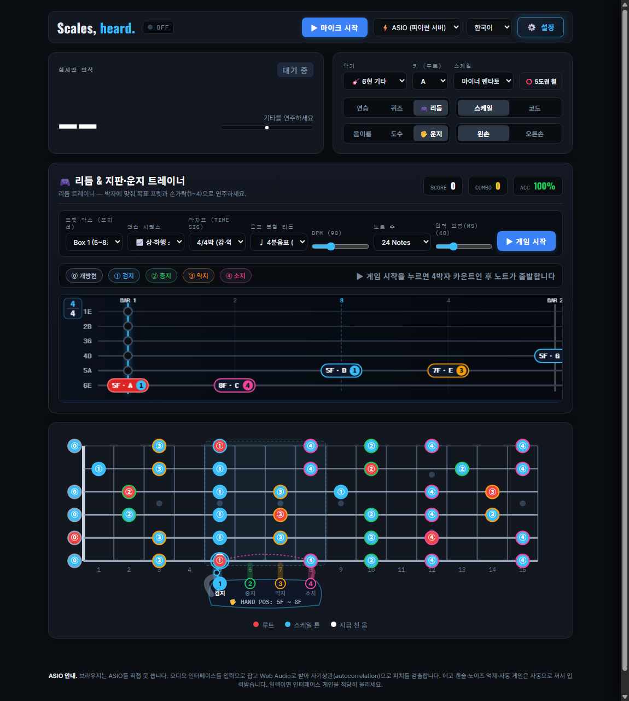
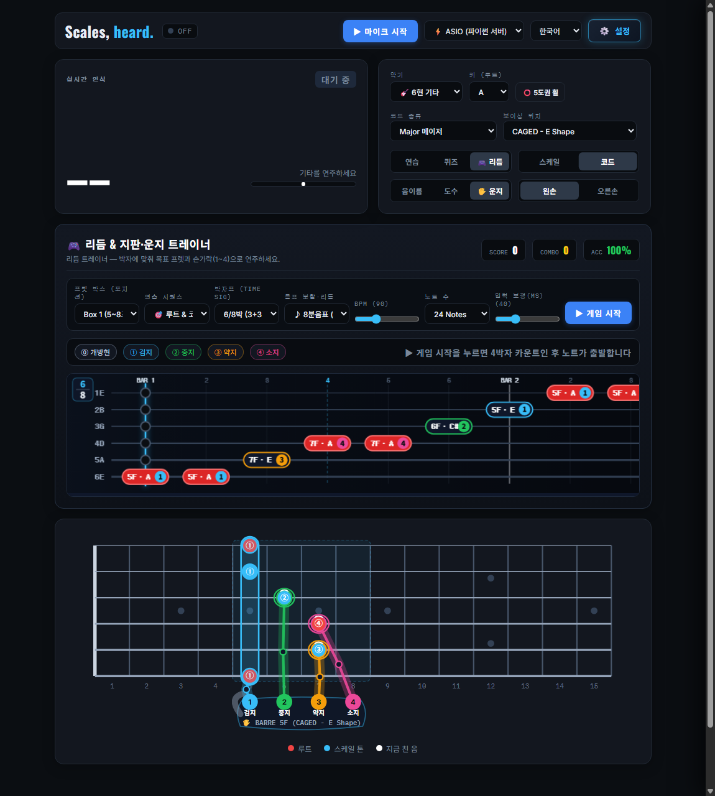

# Scales, heard. 🎸

A powerful, ultra low-latency fretboard **scale guide, rhythm game & ergonomic fingering trainer** in the browser and desktop that **listens to your real electric & bass guitar** in real-time.

[](https://github.com/ManofKimchi08/guitar-scale-tuner/releases)
[](LICENSE)
[]()

---

## 📸 Screenshots & UI Tour

| 🎮 Rhythm & Fretboard Trainer (Scale Run + Hybrid Hand Avatar) | 🖐️ 6/8 Time Signature + CAGED Barre Chord Hand Guide |
| :---: | :---: |
|  |  |

| 🎸 6-String Guitar Fretboard & HUD | 🎸 4-String Bass Guitar (1-5-8 Groove Guide) | 🎙️ 3-Tier Recording Studio & Synced Replay |
| :---: | :---: | :---: |
|  |  |  |

---

## 🌟 Key Features (v2.2.0)

### 1. 🎮 Rhythm & Fretboard Hero (`리듬 & 지판·운지 트레이너`)
- **60fps 6-String / 4-String Note Highway**: Scrolling horizontal string highway synchronized to the Web Audio API hardware clock (`audioCtx.currentTime`).
- **7 Musical Time Signatures (`박자표 Time Signature`)**:
  - **Simple & Compound Meters**: **4/4박** (`강-약-중강-약`), **3/4박** (`강-약-약` Waltz), **6/8박** (`[3+3]` Compound Duple), **12/8박** (`[3+3+3+3]` Slow Rock / Blues), **2/4박** (`강-약`), **5/4박** (`[3+2]` Odd Meter), and **7/8박** (`[2+2+3]` Odd Meter).
  - **3-Tier Metronome Accents**: Distinct Web Audio synthesized clicks for **Downbeat (`강박 1320Hz`)**, **Sub-Accent (`중강박 980Hz` — e.g. beat 4 in `6/8`, beats 4·7·10 in `12/8`)**, and **Weak Beat (`약박 740Hz`)**.
  - **Visual Bar & Sub-Beat Grid**: Displays a live Time Signature emblem (`4/4`, `3/4`, `6/8`, `12/8`), solid bar lines (`BAR 1, 2...`), and cyan dashed sub-accent lines (`3+3` in `6/8`, `3+3+3+3` in `12/8`).
- **11 Note Subdivisions & Groove Patterns (`음표 분할·리듬`)**:
  - Quarter (`♩ 4분음표`), Eighth (`♪ 8분음표`), Eighth Triplet (`🎶 셋잇단음표`), Sixteenth (`♬ 16분음표`), Blues Shuffle (`🎷 블루스 셔플 2:1`), Dotted 8th+16th (`🎯 부점 리듬`), Metal Gallop (`🐎 메탈 갤럽`), Reverse Gallop (`🏇 리버스 갤럽`), Tresillo (`💃 트레시요 3+3+2`), 16-Beat Funk (`🕺 16비트 펑크`), and Classic Rock Riff (`🎸 록 리프`).
- **Real-Time Pitch + Timing Judgement**:
  - Evaluates live guitar audio against target pitch class and hit timing windows: **`PERFECT` (`±45ms`)**, **`GREAT` (`±90ms`)**, **`GOOD` (`±145ms`)**, and **`MISS`**, with configurable **Input Latency Offset (`0 ~ 150ms`)**.
  - Generates an end-of-round **Rank (`S / A / B / C`)**, **Max Combo**, **Average Timing Offset (`ms` Early/Late)**, and **Weak-Spot Finger/Fret Analysis**.

### 2. 🖐️ Hybrid Fretboard Hand Avatar & Smart Fingering (`하이브리드 지판 운지 손 그래픽`)
- **Ergonomic Left-Hand Fingering Engine (`⓪ 개방현`, `① 검지`, `② 중지`, `③ 약지`, `④ 소지`)**:
  - Automatically computes optimal left-hand finger assignments across Open Position (`0~4F`), CAGED Boxes 1–3 (`1-finger-per-fret` & `3-Notes-Per-String` `1-2-4` / `1-3-4` stretches), and High Position (`12~15F`).
  - Supports **CAGED Open & Barre Chord Voicings** with dedicated `openFingers` and `barreFingers` maps.
- **2-Layer Non-Occluding SVG Hand Avatar**:
  - **Back Layer (Under Note Circles)**: Renders a translucent **Ghost Palm & Thumb Silhouette (`🖐️ HAND POS: 5F ~ 8F`)** that smoothly glides along the neck during position shifts, **4 color-coded Knuckle Sockets (`1 검지 Cyan`, `2 중지 Green`, `3 약지 Orange`, `4 소지 Pink`)**, and **2-Segment Articulated Finger Bones (`Proximal Phalanx → PIP Joint → Distal Phalanx`)** so note names, degrees, and finger numbers remain 100% legible.
  - **Tip Layer (Over Note Circles)**: Renders an anatomical **Fingertip Pad + White Nail Crescent** on the active fret, a **Dashed `NEXT` Ghost Finger & Curved Motion Trajectory Arc** previewing the upcoming note, and a full-height **Index Finger Barre Bar (`🖐️ BARRE`)** when playing CAGED barre chords.
  - **Interactive Hover Preview**: Works in both **Rhythm Game Mode** and standard **Practice / Quiz Modes** (hover over any fret or toggle `🖐️ 운지` to inspect how the hand grips that note or chord).

### 3. 🎸 6-String Guitar & 4-String Bass Support
- **Dual Instrument Engine**: Instant toggle between `🎸 6-String Guitar` and `🎸 4-String Bass`.
- **30.0Hz Sub-Bass Detection**: Extends pitch detection down to B0 (30.87Hz), Drop D (36.7Hz), and E1 (41.2Hz) with auto-switching 4096 FFT buffers and YIN + NNLS low-frequency reconciliation.
- **1-5-8 Groove Interval Guide**: Visual amber rings accent the Root (1st), 5th, and Octave (8th) positions essential for bassists.

### 4. 🎙️ 3-Tier Recording Studio & Smart Scorecard
- **Tier 1 (Instant Browser REC)**: One-click recording of guitar audio directly into memory. Supports simultaneous mixing of **backing tracks & metronome**. Export as DAW-ready 16-bit lossless `.wav`.
- **Tier 2 (ASIO Studio Lossless)**: Direct 16-bit PCM WAV disk streaming to `~/Music/GuitarScaleTuner/recordings/ASIO_Take_*.wav`.
- **Tier 3 (Smart Analysis & Synced Replay)**: Automated performance scorecard computing **Total Notes**, **Scale Accuracy (%)**, and **Pitch Stability (%)**, with an interactive **Synced Fretboard Replay**.

### 5. 🎛️ Adaptive Sample Rate Negotiation & High-Performance Audio Engine
- **Automatic Hardware Rate Detection**: Probes device native sample rates (`48000Hz`, `44100Hz`, `96000Hz`, etc.) and eliminates `PaErrorCode -9997` on Windows WASAPI, ASIO, DirectSound, and USB Audio CODECs.
- **Single-Process Dual-Thread Desktop App**: Bundles local HTTP server and WebSocket ASIO engine into a one-click `GuitarScaleTuner.exe` executable.
- **Multilingual Support**: Fully localized in 한국어 (Korean), English, and 日本語 (Japanese).

---

## 🚀 Quick Start

### Option A: Windows One-Click Executable (Recommended)
1. Download and extract the latest release archive (`GuitarScaleTuner-v2.2.0-windows-x64.zip`) from [Releases](https://github.com/ManofKimchi08/guitar-scale-tuner/releases), or clone the repository.
2. Double-click **`GuitarScaleTuner.exe`** (or `Run_GuitarScaleTuner.bat`) in the root folder. No Python installation required!

### Option B: Run from Source
1. Clone the repository:
   ```bash
   git clone https://github.com/ManofKimchi08/guitar-scale-tuner.git
   cd guitar-scale-tuner
   ```
2. Install Python dependencies:
   ```bash
   pip install -r requirements.txt
   ```
3. Launch the unified engine:
   ```bash
   python GuitarScaleTuner.py
   ```
   *Your browser will automatically open `http://localhost:8000`.*

---

## 📖 Deep-Dive Technical Documentation

For in-depth mathematical formulations, DSP algorithms, coordinate descent NNLS chroma solver, and complete architecture diagrams, please read:

👉 **[docs/TECHNICAL_DOCUMENTATION.md](docs/TECHNICAL_DOCUMENTATION.md)**

---

## 🛠️ Project Structure

```
guitar-scale-tuner/
├── GuitarScaleTuner.exe      # One-click Windows root launcher
├── Run_GuitarScaleTuner.bat  # One-click batch launcher
├── GuitarScaleTuner.py       # Unified entrypoint (Daemon HTTP + ASIO WebSocket)
├── asio_server.py            # Adaptive sample rate sounddevice capture & YIN/NNLS solver
├── run_https_server.py       # Path-traversal safe local HTTP web server
├── build_exe.py              # PyInstaller Windows executable packager (auto-cleans build/)
├── index.html                # Responsive studio GUI markup
├── src/
│   ├── main.js               # Web Audio API, SVG fretboard & hand avatar, Rhythm Game, 3-Tier REC
│   ├── style.css             # Dark studio glassmorphism theme
│   ├── i18n.js               # Multi-language dictionary (KR / EN / JP)
│   └── favicon.svg           # High-resolution vector brand icon
├── docs/
│   ├── TECHNICAL_DOCUMENTATION.md  # Engineering whitepaper & DSP spec
│   └── screenshots/          # High-resolution UI screenshots
├── favicon.ico / favicon.png # Windows binary & web application icons
└── recordings/               # Output directory for ASIO lossless WAV takes (~/Music/GuitarScaleTuner/recordings)
```

---

## 📄 License

Distributed under the [MIT](LICENSE) License. Free to use, modify, and distribute for personal and commercial projects.
